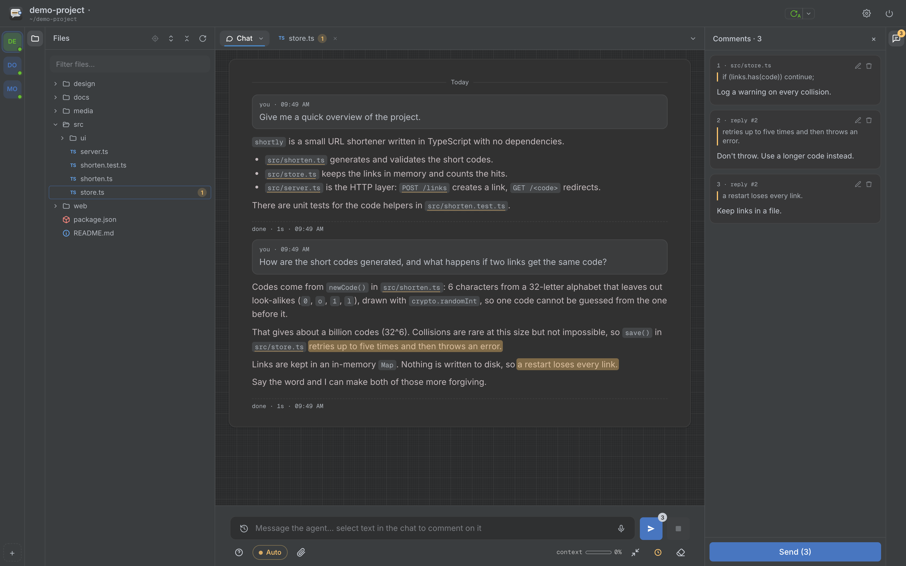
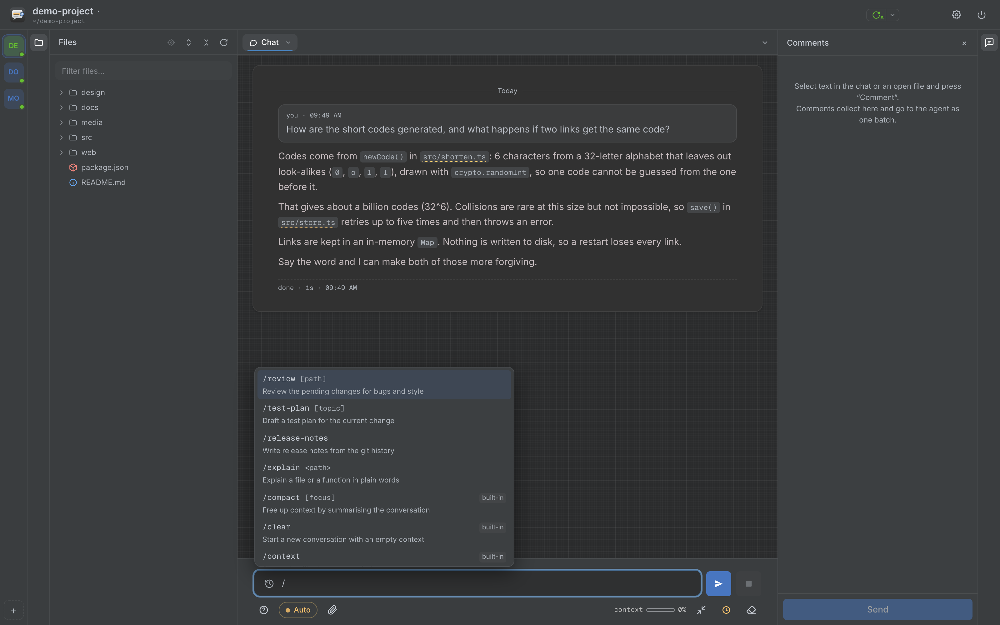
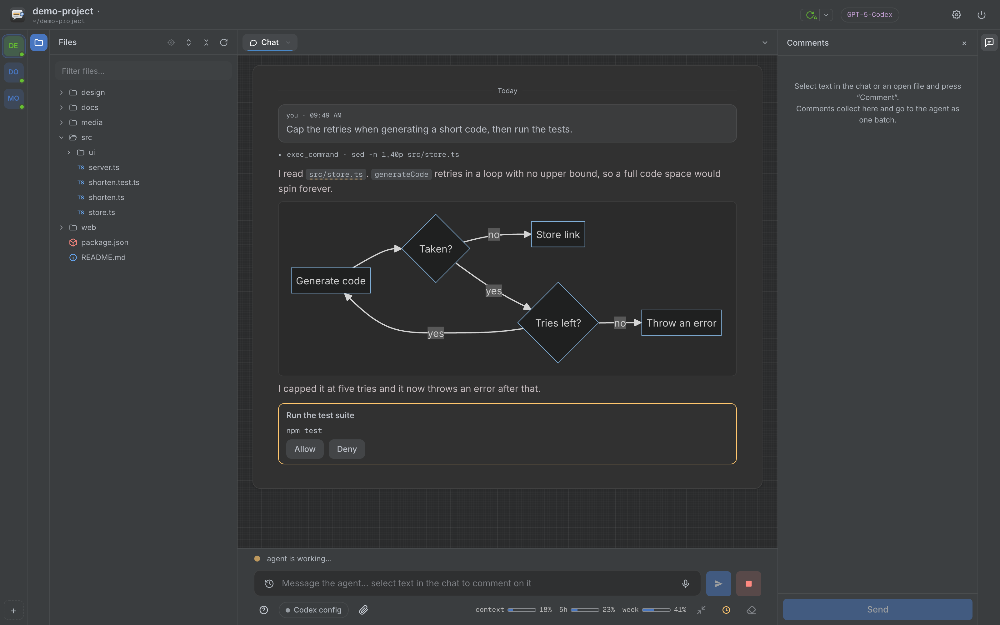

<p align="center"></p>

<h1 align="center">Nota Bene</h1>

<p align="center">
  <strong>A creative agentic environment for media, video, 3D and code.</strong><br>
  Work with <strong>Claude Code</strong>, <strong>Codex</strong> or <strong>omp</strong> on anything you can see and hear: mark up an image or a video frame, comment a moment of a clip, review a diagram, an HTML page or a 3D model, then send it all to the agent as one batch. Code too.
</p>

<p align="center">
  <a href="#what-you-can-do">What you can do</a> ·
  <a href="#agents">Agents</a> ·
  <a href="#install">Install</a> ·
  <a href="#phone">Phone</a> ·
  <a href="https://github.com/iCubeDm/nota-bene-ide/blob/main/docs/guide.md">Guide</a> ·
  <a href="https://github.com/iCubeDm/nota-bene-ide/blob/main/CHANGELOG.md">Changelog</a>
</p>


Nota Bene opens the agent you already have (its own login, models and sessions) in a browser window made for review. Whatever the agent produced, you point at the exact spot, write what is wrong in the margin, and send every note at once. The agent gets each fragment, each marked picture and your words on it in one message.

## What you can do

**Images.** Open an image from the project, a screenshot the agent left in `/tmp`, or one you pasted into the message. Draw a rectangle, ellipse, arrow or freehand line on it, or outline an exact area point by point with a mask, and comment; the agent receives the picture with your marks drawn on it (and a mask as `mask.png`).


**Video and audio.** A player with frame stepping, speed, picture in picture and keyboard control. Pause on a frame, mark it up and comment: the comment keeps its moment and shows as a tick on the timeline. Audio files play and seek in the same player.

**3D models (experimental).** `.glb`, `.gltf` and `.blend` (through your Blender) open in an orbit viewer with animation clips. Mark up a view; the comment remembers the camera. Off by default; macOS and Linux only.

**Pages and diagrams.** An HTML page renders in a tab with its scripts off. Comment on its text, click an element, or drag a box over an area of an SVG diagram; the agent gets the place as it reads on the page. Mermaid and SVG in replies render as diagrams.

**Code.** Margin comments on replies, files and diffs; a file tree with editing, branches and worktrees, a Changes view and the Git log; `@` file mentions, `/` commands and skills, `!` shell commands.


**Steering the agent.** A message sent mid-turn joins it; permission requests, plans and questions are cards you answer in the window. Subagents get their own tabs, background tasks a drawer. Voice messages and voice comments are transcribed on your computer with Whisper (optional). Open projects sit in a rail on the left, one click apart. Sessions, archives and the history from before each compaction; a Usage tab for tokens and plan limits across projects; updates in one click.


**Video editor (new in 2.1.0).** An edit (`*.nbcut.json`) opens as a timeline: video and photos on stacked tracks, sound with its waveform, gain and fades, mute and solo, and a preview with a level meter. Comment a clip or a moment like anything else; the agent writes the edit as JSON, and what it changed is highlighted on the timeline. Export renders MP4, WAV or M4A with ffmpeg. See [Video edits](https://github.com/iCubeDm/nota-bene-ide/blob/main/docs/guide.md#video-edits-nbcutjson).




<details>
<summary>More screenshots</summary>






</details>

## Agents

| Agent | Needs | Open a window from it | Status |
|---|---|---|---|
| **Claude Code** (default) | Claude Code, logged in | `/nb` | Stable |
| **Codex** (CLI and local Desktop) | Codex CLI 0.166.0+, `codex login` | `$nb` | Stable; [a few native gaps](https://github.com/iCubeDm/nota-bene-ide/blob/main/docs/guide.md#codex-support) |
| **omp** | omp 18.16.0+, logged in | `/skill:nb` | Preview; [limits](https://github.com/iCubeDm/nota-bene-ide/blob/main/docs/guide.md#omp-support) |

Models are those of your agent account (for omp, any provider set up in it). Without an agent session, `nota-bene` in a terminal starts the agent itself; with several installed it asks which (`--agent claude|codex|omp` skips the question). Two agents can work in the same project.

## Install

Node.js 22 or newer. Runs on macOS, Linux and Windows ([platforms](https://github.com/iCubeDm/nota-bene-ide/blob/main/docs/guide.md#starting-a-window)).

<details open>
<summary><strong>Claude Code plugin</strong> (recommended)</summary>

```
/plugin marketplace add iCubeDm/nota-bene-ide
/plugin install nota-bene@nota-bene
```

Then type `/nb` in a project (`/nb new` for a fresh session, `/nb fork` to carry the conversation over; `/nota-bene:nb` if another skill is called `nb`). The first `/nb` installs the npm package (about 330 MB) into the plugin's data folder.

</details>

<details>
<summary><strong>Codex plugin</strong></summary>

```sh
codex plugin marketplace add iCubeDm/nota-bene-ide --ref main
codex plugin add nota-bene@nota-bene
```

Reload skills or restart Codex, then use `$nb`, `$nb new` or `$nb fork` (or pick nb in the Desktop skill picker). The first use downloads about 70 MB. A window started from Desktop keeps running after the turn; **Stop Nota Bene** (⏻) shuts it down.

Without the plugin: `npm i -g nota-bene-ide` (`--omit=optional` if you only use Codex), then ask Codex:

```text
$skill-installer Install the nb skill from https://github.com/iCubeDm/nota-bene-ide/tree/main/codex/skills/nb
```

The installer copies the skill, so this also works on Windows.

</details>

<details>
<summary><strong>omp</strong></summary>

```sh
npm i -g nota-bene-ide
ln -sfn "$(npm root -g)/nota-bene-ide/omp/skills/nb" ~/.omp/agent/skills/nb
```

On Windows, in PowerShell, link it with a junction:

```powershell
npm i -g nota-bene-ide
New-Item -ItemType Junction -Path "$HOME\.omp\agent\skills\nb" -Target "$(npm root -g)\nota-bene-ide\omp\skills\nb"
```

Then `/skill:nb`, `/skill:nb new` or `/skill:nb fork`, or `nota-bene . --agent omp --detach` from a terminal.

</details>

<details>
<summary><strong>Terminal, any agent</strong></summary>

```sh
cd your-project
npx nota-bene-ide                   # Claude
npx nota-bene-ide . --agent codex   # or omp

npm i -g nota-bene-ide              # or install the command once
nota-bene
```

The same works in PowerShell or `cmd`.

</details>

Then select a sentence of the agent's reply, press **Comment**, add a note and press **Send**. The [Quick start](https://github.com/iCubeDm/nota-bene-ide/blob/main/docs/guide.md#quick-start) walks through it with an image and a video.

## Phone

An Android app (a prototype) drives your windows from a phone: chat, files, Git changes, comments with markup, images and voice messages, with notifications when an agent finishes or waits for you. It connects through a relay you run yourself, end-to-end encrypted, and pairs with a QR code from the window's Remote tab. See [Remote access](https://github.com/iCubeDm/nota-bene-ide/blob/main/docs/guide.md#remote-access).

## Updating

From 1.7.0 on, a window updates itself: the header shows `↑ <version>`, **Update** installs it and the window restarts in a pause with the same session; **Update automatically** does it for every release. See [Updates](https://github.com/iCubeDm/nota-bene-ide/blob/main/docs/guide.md#updates).

<details>
<summary>Versions up to 1.6.0: update once by hand</summary>

```sh
npm i -g nota-bene-ide@latest                  # terminal
claude plugin marketplace update nota-bene     # Claude Code plugin,
claude plugin update nota-bene@nota-bene       #   then restart Claude Code
codex plugin marketplace upgrade               # Codex plugin
codex plugin add nota-bene@nota-bene
```

Then close the old windows and open them again: a `/nb` window is a background task of its Claude Code session (stop it in `/tasks`), a terminal window stops with Ctrl+C. Sessions, comments and settings stay.

</details>

## Guide

[The guide](https://github.com/iCubeDm/nota-bene-ide/blob/main/docs/guide.md) covers every feature by task, hotkeys, the security model, where state is kept and troubleshooting. How it is built: [architecture](https://github.com/iCubeDm/nota-bene-ide/blob/main/docs/architecture.md).

## Contributors

- [Milos Marinkovic](https://github.com/milosmns): the omp backend over ACP (1.5.0).

## Licence

Apache-2.0. See [LICENSE](https://github.com/iCubeDm/nota-bene-ide/blob/main/LICENSE) and [THIRD-PARTY-NOTICES.md](https://github.com/iCubeDm/nota-bene-ide/blob/main/THIRD-PARTY-NOTICES.md).
