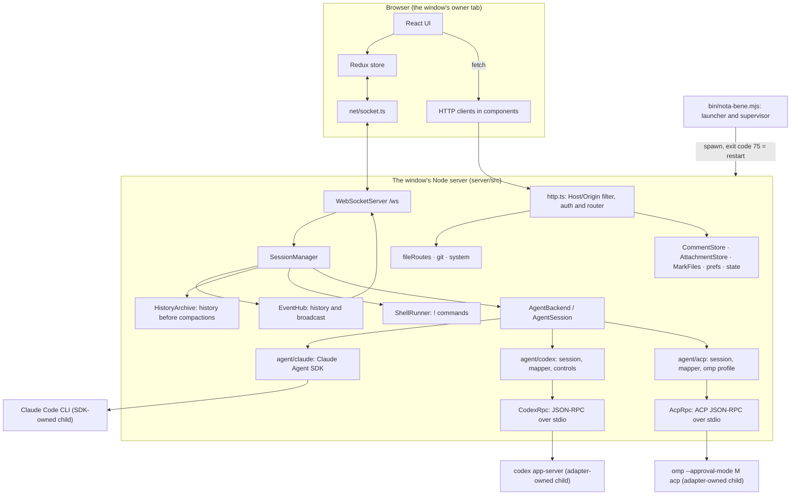
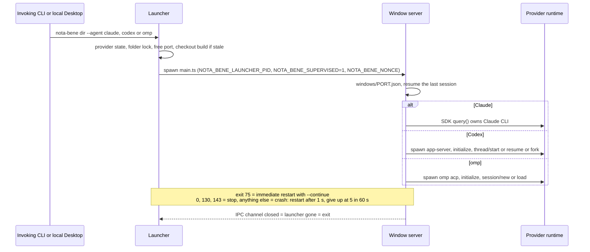
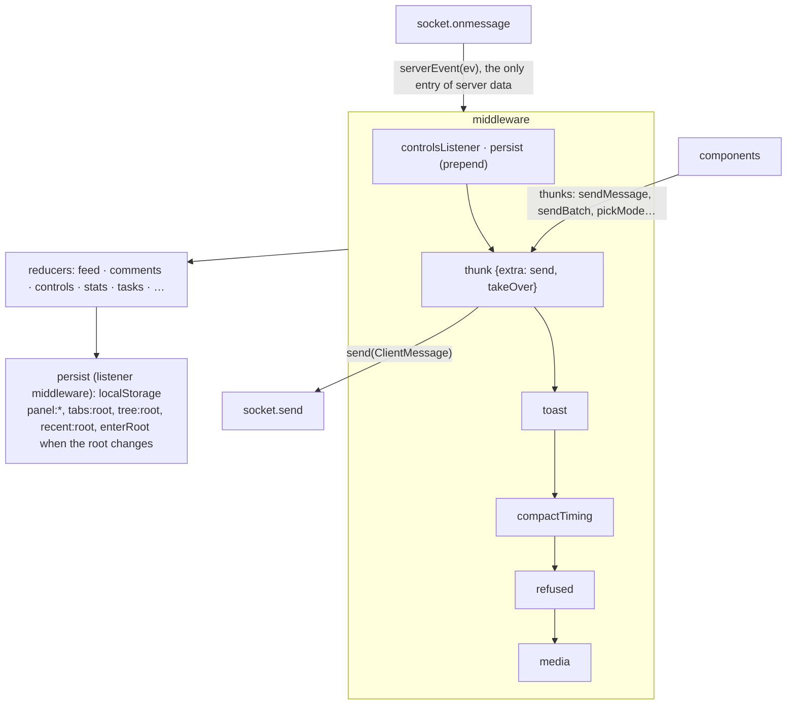
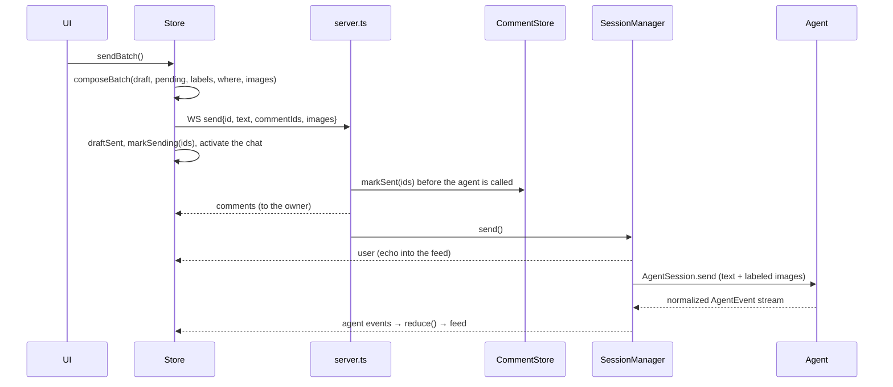

# Nota Bene architecture

How the parts fit. Operational rules and the security model: [agent reference](agent-reference.md). User-facing behavior: [guide](guide.md).

## 1. Overview

Nota Bene is a local web application. One **window** is one server process, one project folder, one port from 4777 to 4799 and one agent session (Claude Code, Codex or omp). The provider is fixed at launch; session discovery and persisted state are scoped to it. One browser tab works with the window (the owner); other tabs see "the window is already open" and can take it over.

All providers implement the same `AgentBackend` / `AgentSession` contract. The
server selects one at startup; the browser consumes normalized events and declared
capabilities. Claude SDK types, Codex RPC frames and ACP frames stay inside their adapters.
omp runs on a generic ACP adapter (`agent/acp/`): transport, mapper and session are
agent-neutral; `acp/omp.ts` is the profile with omp's binary, launch flags, approval-form
wording, hidden commands and error texts.



**Packages** (npm workspaces):

| Package | Contents |
|---|---|
| `shared/` | The contract shared by web and server. `protocol.ts`: the protocol types (`ClientMessage`, `ServerEvent`, `Comment`, `Anchor`, `MediaShape`, `Capabilities`), the validator `parseClientMessage` and the `PROTOCOL` version. `agent.ts`: the normalized `AgentEvent`. `tasks.ts`: the pure task reducer `reduceTasks`. |
| `server/` | In a checkout, Node >= 23.6 runs the `.ts` files directly, with no build. The published package ships the server compiled to plain JS (Node >= 22). Dependencies: `@anthropic-ai/claude-agent-sdk` and `ws`, nothing else (no HTTP framework). |
| `web/` | React 19, Redux Toolkit 2, Radix UI, Tailwind 4, Vite 8. Markdown on `marked` + `dompurify` + `highlight.js` + `mermaid`. Fonts (Inter, Geist Mono) are bundled; the page makes no request to a font service. |
| `bin/nota-bene.mjs` | The launcher: port choice, folder lock, rebuild of a stale `web/dist`, supervision, and the helpers `--find`, `--last`, `--url`, `--front`. |
| `codex/` | Codex marketplace plugin (`plugin.json`) and CLI/Desktop skill (`skills/nb/`). `.agents/plugins/marketplace.json` selects this plugin for Codex. |
| `omp/skills/nb/` | The omp skill (`/skill:nb`): `open.mjs` opens a detached omp window, `new`, or a fork of the invoking omp session. |
| `plugin/skills/nb/` | The `/nb` skill for Claude Code (inside the plugin `plugin/`): `node open.mjs --plan / --wait / --run` (a Node script, so it runs on Windows too). |
| `e2e/` | Playwright on scripted fake agents, plus Codex and omp browser acceptance through fixture agents (`codex.config.ts`, `omp.config.ts`). |
| `relay/`, `mobile/` | The Go relay for remote access and the Flutter phone app ([2.3](#23-remote-relay)). |

## 2. Processes and lifecycle



- **Supervision runs both ways.** The launcher restarts the server. The server exits by itself if the launcher is gone (`watchLauncher`): it is spawned with an IPC channel and stops when the channel closes, which also carries the launcher's stop message (Windows has no SIGTERM). A foreground launcher in turn stops when the shell that started it is gone (`watchParent`), unless it is a `--detach` child. Launcher environment variables that were not inherited from the direct parent are dropped (`dropInheritedLauncherEnv`), so a test server started from inside a window does not think it is supervised.
- **The launcher's secrets.** A per-launch nonce, kept by exit 75 and replaced after a crash ([Access token](agent-reference.md#access-token)).
- **The window registry** `~/.nota-bene/windows/<port>.json` serves "one window per folder per provider" and Settings, Windows. Codex and omp keep theirs under `providers/<provider>/`, with their own locks and tokens. A launch takes a per-folder lock (`locks/<hash>`), then gives way to a window already serving the folder, waiting up to 10 s for one that is in its restart gap.
- **The Whisper host.** Dictation and voice messages share one detached `host.js` process per state folder (`server/src/dictation/hostMain.ts`), which holds the one Whisper model, takes every window's jobs over a private unix socket (Windows: a named pipe) in one round-robin queue, and exits after 10 minutes idle. A window that cannot use it runs the model itself. Details: [Whisper host](agent-reference.md#whisper-host).
- **Control between windows.** Window A sends `POST /system/windows/action`; its server proxies the request to `127.0.0.1:<port B>/control/<action>` with the token from `<stateDir>/control-token` (mode 600). `/control/*` rejects any request that has an `Origin` header, so only a server can reach it, never a page.

**Invoking-host lifetime.** Claude's `/nb` owns a background launcher tied to its
calling session. The Codex skill uses an owned background process in CLI, or
`--detach` from local Desktop. A detached supervisor survives the end of the
invoking turn; explicit Stop in the window ends it. A window already open for the
same project and provider is brought forward; a requested new/fork is not applied
to that existing conversation. Fork requires the invoking host's actual session id.

### 2.1 Package

`scripts/build-package.mjs` builds the npm package into `pkg/`. The server and the launcher are bundled by esbuild into JS at the same directory depth as the sources (so the relative `import.meta` paths to `web/dist` stay correct), `@nota-bene/shared` is inlined, the Whisper host is a third bundle (`server/src/host.js`, beside `main.js`), and `web/dist` is built fresh. The installed package has no `web/src` and no `.git`: the launcher never builds, `codeChanged` is always false, and the version comes from `package.json`. Claude's `/nb` skill finds the launcher in a checkout first, otherwise it installs the package `nota-bene-ide@<plugin version>` into the plugin's data folder on the first run.

### 2.2 Codex plugin distribution

The repository has separate marketplaces for the two hosts: Claude reads
`.claude-plugin/marketplace.json` and installs `plugin/`; Codex reads
`.agents/plugins/marketplace.json` and installs `codex/`. The latter contains a
portable `plugin.json`, `skills/nb/SKILL.md` and `open.mjs`. The skill runs the helper
through `npm exec --yes --omit=optional --package=nota-bene-ide@<version> -- node ...`,
so first use fetches the pinned runtime and later uses npm's cache. `--omit=optional`
skips the SDK's per-platform Claude binary (about 70 MB instead of 330 MB); the SDK's JS
stays and loads, and only a Claude session would need the binary. No global npm installation
or manual skill copy is required. The helper selects `--agent codex`, handles
CLI/Desktop lifetime and redacts browser login fragments from its output.

The npm archive holds the compiled application and the standalone Codex and omp skills;
the marketplace manifest comes from GitHub. A `v<version>` tag identifies the exact npm
source; plugin or docs changes may follow it on `main` without replacing the archive.
The marketplace is for local clients, not a listing in the public ChatGPT plugin directory.

### 2.3 Remote relay

`relay/` holds `nb-relay`, a separate Go program for remote control: a stateless WebSocket hub that pairs a host (the Nota Bene server on a computer) with its devices (phones) by host id and forwards opaque frames. It stores nothing except the TLS certificate cache, and its admission checks are only a noise filter; the real authentication and confidentiality are the end-to-end handshake between host and phone. The hub is the importable Go package `relay/hub`; `relay/cmd/nb-relay` wraps it with TLS and flags, and with `-members` admits only hosts whose hello is signed by an operator-issued Ed25519 access key, a set number of hosts per key, from a file it re-reads (`members.go`; `invite`, `revoke`, `limit` and `members` edit it). The wire contract is [relay/PROTOCOL.md](../relay/PROTOCOL.md); building, running and the container image are in [relay/README.md](../relay/README.md).

The host side is `nota-bene remote` (`server/src/remote/`), one process per user. It keeps one outgoing connection to the relay (`relayClient.ts`), finds the windows of all three providers in their registries and proves each with that provider's token before sending anything (`discover.ts`), and runs one end-to-end channel per phone connection (`device.ts`): Noise IK (`noise.ts`, on `node:crypto`, checked against the official vectors), then a stream mux with per-stream and per-connection credit (`mux.ts`) carrying the host's window list, WebSockets to a window's `/ws` and HTTP requests to its routes, with the window's helper bearer added on the host. Pairing, the device list and revoking are in `connector.ts`; `pair`, `devices` and `revoke` reach the running connector over a Unix socket (`control.ts`). Every window keeps one connector running while a relay is saved (`keeper.ts`, as the Whisper host is kept), serves the Remote tab's `/remote` routes (`routes.ts`) and sends the page its state as the `remote` event. The channel's contract, for the phone's implementation, is [server/src/remote/CHANNEL.md](../server/src/remote/CHANNEL.md). The same connector is also a device of other computers (issue 297): `hostLink.ts` is the device end of the channel (relay admission as a device, the Noise initiator, the mux), with its own `device.key`; `pairHost` pairs with another computer's code, and one `HostLink` per computer in `hosts.json` keeps the channel and that computer's `windows` list. A window keeps the connector running for these links even with no relay of its own. A window's `GET /system/projects` adds each online computer's windows as rows with `remote: {host, name}` (the connector's `computers` control op; `projects.ts` `remoteRows`), and `POST /system/remote/open` has the connector open a desktop proxy for one (`proxy.ts`): a loopback listener per open on a port the system picks, outside the windows' range, served as `localhost` while the windows stay on `127.0.0.1`, so the other computer's pages and this one's windows share no cookie and are different sites. It runs its own auth with the window's code (`auth.ts`: token, login, cookie, key, the `nb.<key>` subprotocol, the Origin) and strips it; requests go over the channel as `http` streams with the helper bearer added on the other computer, before the page logged in as `public` streams without it (the app shell only), and `/ws` as a `ws` stream. It answers `GET /system/remote/page` (`{host, name}`: the page hides what that computer's page cannot do, `web/src/net/local.ts`) and `/system/projects` itself, and refuses the rest of what a device may not reach (`device.ts` `goodPath`) with 403. The switch from such a page is a top-level navigation to its `/system/remote/enter`, which only a same-origin navigation passes (`Sec-Fetch-*`) and which answers with a 303 to the target's login: page code never reads the redirect or its fragment, so it never holds a credential for this computer's windows. A listener closes a minute after its last connection, and keeps the connector up while it lives. All of a computer's tabs share its one channel (64 streams, 512 KiB window).

The phone side is in `mobile/`: `mobile/channel` (`nb_channel`, pure Dart) is the same channel from the other end (Noise IK on the `cryptography` package, checked against the same vectors and worked examples; the mux; relay admission), proved end to end against the real relay and connector by `cross_test.dart`, which drives `server/src/remote/crossHost.ts`. `mobile/app` (`nb_app`, Flutter, Android) keeps one link per paired host (`hosts/host_link.dart`) and is an ordinary tab of a window over it (`chat/window_tab.dart`, the feed a port of `web/src/store/feed.ts`); it uses the protocol types generated into `mobile/protocol`. Build and test commands are in [mobile/README.md](../mobile/README.md).

### 2.4 Projects across windows

Until one server holds every project (design: [one tab for all projects](superpowers/specs/2026-11-15-one-tab-projects-design.md)), the header's project switcher works over today's windows. The current window's server reads every provider's registry and proves each listener with that provider's token, as the connector does (`server/src/projects.ts`). To move a tab, it derives the target's login value from that token, the port and the proved nonce, exactly as the launcher's `loginTarget` does. The value goes only into the JSON answer; the page navigates to it. To open a folder, it runs its own launcher with `--detach --no-open`, without this server's launch-state variables, and returns the URL from the launcher's one line (`server/src/projectRoutes.ts`). The launcher records each launch in `recent.json` in the base state folder (`server/src/recent.ts`). The web side is `web/src/projects/`.

The menu is a list of chats: the web folds the windows of one folder into one row (`rows.ts`) and shows one badge, `!` for a window that waits, else the replies not seen. A window keeps, per session, when the person last saw it (`seen-sessions.json` in its provider's state folder, `server/src/seen.ts`); its page posts `/seen` while it is visible and focused, and `/info` reports `unseen`, the final replies after that time (a time, not a count: a compaction drops replies from the history). Another window's sessions come through `POST /system/projects/sessions`, which proves the window as above and reads its `/sessions` with the helper bearer. Opening a session in another window rides on the login hand-off: the URL is `#t=<login>&s=<id>` (or `&s=new`), and that page switches once it is logged in (`web/src/projects/landing.ts`); no server-to-server switch is needed.

## 3. Server

### 3.1 Modules

| Module | Responsibility |
|---|---|
| `main.ts` | Argument parsing, choice of what to resume, exit code 98 when the port is taken, the launcher watchdog. |
| `server.ts` | Composition: the stores, `SessionManager`, the HTTP router and the WSS; the dispatcher of WebSocket messages and the link between comments and the session. One tab per window (owner socket, 700 ms reload grace, 30 s ping, `takeover` closes the old owner with 4001, `?passive=1`). Messages the agent's `capabilities` forbid are rejected as `server-error`. |
| `auth.ts` | The access token and every value derived from it ([Access token](agent-reference.md#access-token)). |
| `stateGuard.ts` | Knows the folders that hold secrets (the current state folder and the two default ones) and refuses to serve, list or search anything inside them. |
| `http.ts` | No framework. Order: Host allowlist, then `/control/` (token, no Origin) or Origin for non-GET, then the open routes (`/auth`, `/hello`), then auth for everything else, then the routes, `/info`, and last the static files of `web/dist` with an SPA fallback. |
| `hub.ts` | `EventHub`: the in-memory event history of the current session. A connecting socket gets `replay` (with `earlier`, the number of archived segments), then live events. `reset()` replaces the history (switch, `/clear`, restart). `cut()` moves everything before a compaction boundary into the archive; some events (sends not yet finished) stay in both the history and the archive. |
| `archive.ts` | `HistoryArchive`: `history/<sid>.jsonl`, one line per segment (the conversation before a compaction), fsync on write, a broken line is skipped. The route `/history?session=&before=`. |
| `subagent.ts` | `GET /subagent?session=&tool=`: the conversation of the subagent started by an Agent call, through `AgentBackend.subagent(...)`. The Claude backend maps the tool-use id to the agent id from `agent-<id>.meta.json` (not an SDK API; read only in `agent/claude/subagents.ts`); Codex reads native child threads. |
| `taskOutput.ts` | `GET /task-output?session=&task=`: the tail of a background shell or Monitor task's output (Claude: SDK `get_task_output`; Codex declares `taskOutput: false`). |
| `session.ts` | `SessionManager`, a facade: `pump()`, the wiring of the parts, and the public methods (`send`, `switchTo`, `restart`, `setMode`, `shellRun`, …). |
| `session/` | The manager's parts: `phase` (the phase `live / switching / closed`), `turns` (`TurnLedger`: accounting of sends), `permissions` (`PermissionBroker`), `title`, `agentSlot` (the agent and its generation `gen`), `identity` (id, root, model, fork), `mode`, `sendQueue`, `target` (check of a switch target), `archiveCut` (the cut at `compacted`), `history` (loading the feed), `idleWiring`, `images`, `options`, `types`, `commands` (`CommandKeeper`: the slash menu's list) and `shell` / `shellText` (`ShellRunner`: the `! cmd` runs, below). |
| `agent/types.ts` | The interfaces `AgentBackend` / `AgentSession`, the seam for replacing the agent. The agent produces `AgentEvent`; `capabilities` declare what it can do. |
| `agent/claude/` | The Claude backend: `sdk.ts` (`query()` with streaming input, `canUseTool` to `PermissionAsk`, the `claude_code` preset prompt plus `APPEND`, `--chrome` for the browser tools), `map.ts` (SDK frames to `AgentEvent`, the only place SDK keys enter the stream), `transcript.ts` (replay), `commands.ts` (the `/` menu: commands and skills, plus the built-ins in `BUILTIN_OK`, never one the CLI tags `terminal_slash_commands`). |
| `agent/provider.ts`, `agent/bin.ts` | Validates `claude` / `codex` / `omp` and derives provider state folders (Claude is the default); the one way to spawn an agent CLI. |
| `agent/codex/` | The Codex adapter over its owned `codex app-server` ([3.5](#35-codex-adapter-and-native-ownership)). A CLI older than `CODEX_MIN_VERSION` is refused before any native call. |
| `agent/acp/` | The generic ACP adapter (`rpc.ts`, `map.ts`, `session.ts`, `backend.ts`); `omp.ts` is the omp profile. |
| `agent/fake.ts` | A scriptable backend for e2e. |
| `tmpImage.ts` | `GET /tmpimage?path=`: an image the agent left in a system temp folder, key tier only ([Access token](agent-reference.md#access-token)). |
| `prompts.ts` | `PromptStore`: `prompts/<sessionId>.jsonl`, the prompts sent (`typed`, `shell`, `voice`). They cannot be rebuilt from the transcript (batches and `! cmd` are rewritten there), so the page POSTs each one the server has taken. |
| `comments.ts` | `CommentStore`: `comments/<sessionId>.v2.json` `{v: 2, rev, items, removed}`. `rev` grows with every change; `removed` keeps the last 500 deleted ids, so no add brings one back. `apply()` takes a client's ops all or none, `merge()` an older client's whole set. A session without an id lives in memory until `adopt()`. |
| `attachments.ts` | Content-addressed images (`sha256.ext`) up to 3.75 MiB, and voice recordings (`sha256.wav`, protocol 14). `POST /attach`, `GET /attach/<id>`, restoring from the trash. |
| `voice/`, `dictation/` | Voice messages: `POST /voice` stores a 16 kHz mono WAV, `GET /voice/<id>` serves it, `POST /voice/<id>/text` transcribes it through the Whisper host. A `send` with `voice` is transcribed in the send queue before the agent gets the text. `dictation/` holds the install, the host and its client. |
| `marks.ts` | The marks in the project folder: `<root>/.nota-bene/marks/<commentId>/{frame.jpg,layer.png,mask.png}` (`mask.png`: a drawing with polygons), with a self-ignoring `.nota-bene/.gitignore` (`projectDir`, which the video editor's reversed copies in `.nota-bene/reverse/` share). Magic-byte check, symlinks refused. |
| `fileRoutes.ts`, `files.ts`, `git.ts` | `/tree`, `/file` (Range, sandbox headers), `/complete`, `/sources`, `/git-status`. Sources: the current checkout, other worktrees (from disk) and branches (through git blobs). |
| `vcs.ts` | The read-only git views: `/vcs-diff`, `/vcs-file`, `/vcs-branches`, `/vcs-log`, `/vcs-commit`, `/vcs-commit-file`. Every call runs with `--no-optional-locks`, so polling never takes `index.lock` from an agent. A failed git is a 503, never an empty answer. |
| `system.ts` | Settings: about, prefs, storage and cleaning into the trash, windows, the control token. |
| `projects.ts`, `projectRoutes.ts`, `recent.ts`, `seen.ts` | The project switcher ([2.4](#24-projects-across-windows)). |
| `update.ts`, `runtime.ts`, `updater.ts` | The in-app update ([agent reference](agent-reference.md#in-app-update)). |
| `restartGate.ts`, `turnMarks.ts` | The deferred server restart and the cut-turn note. |
| `osFiles.ts`, `fileEdit.ts`, `gitSwitch.ts` | Reveal and Open on the desktop, saving an edited file, switching the checkout's branch. |
| `cut/` | The video editor's server side: export with ffmpeg, new edits, waveform peaks, reversed copies of clips for the preview. |
| `remote/` | The remote connector ([2.3](#23-remote-relay)). |
| `sessions.ts` | The route `/sessions`, titles, and each Claude session's working folder from the head of its transcript. |
| `range.ts`, `errors.ts`, `codeStamp.ts` | HTTP Range parsing; `reportError` / `guard` (a failure becomes a `server-error` event); "the server's own sources changed since start" for `/info`. |
| `audit.ts` | `AuditLog`: `<NOTA_BENE_HOME>/audit/YYYY-MM-DD.jsonl`, one `appendFileSync` per line so windows sharing a day file never cut into each other's lines. It taps the hub and the owner's client messages, and keeps only names, ids, counts and numbers, never text. A failed write turns the log off for the run, never the window. |
| `prefs.ts`, `state.ts`, `windows.ts` | JSON state files (written through tmp + rename). `state.ts` also owns the state folder (created 700) and refuses one owned by another user. |
| `stats.ts`, `idle.ts` | Context, limits and cost through `AgentSession` (Codex cost is unknown). Idle compaction. |

`usage/` is independent of the session: `parse.ts` turns transcript lines of Claude and Codex into normalized records, `importer.ts` reads new bytes incrementally under a lock, `store.ts` keeps `<NOTA_BENE_HOME>/usage/`, `report.ts` builds the `UsageReport`, `routes.ts` serves it. The only link to a live session is `onStats`, through which main.ts records Claude's limit readings, which no transcript keeps.

### 3.2 How SessionManager works

`createSessionManager` is the facade in `session.ts`: it owns `pump()` and ties together the parts in `session/`. Each part owns its own state; the strictness is where the server itself makes the transition.

- **Window phase (`Phase`).** `live → switching → live` and the irreversible `closed`. Closing in the middle of a switch makes the phase `closed` at once, but `switching` holds until `endSwitch()`; no new agent starts.
- **Accounting of sends (`TurnLedger`).** Each send goes `queued → running → answered | cancelled | failed`. The flags of `/clear` and `/compact` (`commandDue`, reset, compaction inside a turn) live here too. It is strict where the server takes the step and tolerant where the CLI does (a turn-end for an unknown or already closed id is ignored).
- **Agent and generation (`AgentSlot`).** The generation `gen` grows at every teardown (switch, close). Everything the old agent may send later (messages, permission requests, answers to mode and title, a deferred send) carries its own `g` and is dropped when `g !== gen`. This is the main defence against events of an old session leaking into a new one.
- **`SendQueue`** replaced `chain`: sends go to the agent one at a time, so the interrupt of a `force` send arrives after the earlier sends and before it, and a send from a past generation is dropped quietly.
- **`PermissionBroker`**: a request goes `open → answered | aborted`; an answer to an unknown or closed request is ignored (a second socket, a click after withdrawal).
- **`pump()`** reads `a.messages`, a stream of `AgentEvent` (Claude SDK frames are translated by `agent/claude/map.ts`; Codex notifications/items by `agent/codex/map.ts`):
  - it reconciles `waiting` with `turn-end` by `answers` and with `cancelled`;
  - main-thread output (text, or a tool call that is not a subagent's) while no send waits is a turn the agent started itself, for example woken by a background task's notification: it emits `turn-start` (stored, so a reload shows it) and counts as busy until the next `turn-end`, a crash or a reset;
  - when the agent dies, its tasks still running end as `stopped` (nobody else would say so, and a running task holds an update back);
  - it intercepts `reset` (`/clear`);
  - it watches `init` (session id, model, mode, the entry in `sessions.json`) and `compacted`;
  - everything except `init` and `rate-limit` and `commands` (which are handled separately) goes to the hub as `{kind:'agent', e}` (protocol 5).
- **Cut at compaction (`archiveCut`).** After the `compacted` event, in the same synchronous step where the generation was checked, `hub.cut()` writes the conversation before the boundary to the archive. The replay keeps what follows it, plus sends not yet finished (including the `/compact` itself). A write error is reported and cuts nothing. A conversation with no id of its own (a new session before `init`, a fork before its new id, a session after `/clear`) has no cut, and **a fork never offers its parent's archive**: `SessionIdentity.ownId` is `null` for it, `earlier` in the replay is 0, and `/history` answers 409.
- **`switchTo`**: check the target (`target`), then teardown (`gen++`, close the agent, wait for the loop to end for at most 5 s), then new state, then `load()` (`hub.reset` + transcript replay + `resumed`), then mode/idle/stats, then the `onSwitch` listeners, then `ensureAgent()`. A new session may only be opened in the current root or in a folder that already has sessions: a local client must not be able to re-root `/file` to `/` or `~`.
- **`restart`** is `switchTo(sessionId, root, restart=true)`. It is an escape hatch: it is allowed while the agent is busy (the interrupt takes at most 2 s).
- **Slash commands (`CommandKeeper`).** The list is asked from the agent once it is up, replaced whenever the agent pushes `commands_changed`, sent to every new socket (never stored) and emptied by a switch. A `/compact` or `/clear` typed in the composer is tracked like the buttons.
- **Shell commands (`ShellRunner`).** A one-line draft starting with `!` becomes `shell-run {id, cmd}`. The server runs it in the project folder in its own process group, independent of the agent, one at a time, as a feed block (`shell-start`, live `shell-out`, `shell-end`). Finished runs are queued and put in front of the next `send` by `takeFor()` in Claude Code's own form; they cause no turn. Rules: [agent reference](agent-reference.md#session-rules).

### 3.3 Protocol

Two channels with a clear split:

| Channel | What goes through it | Why |
|---|---|---|
| **WebSocket `/ws`** | Live session state: `agent` (`AgentEvent`), `user`, `permission*` (including structured interactions), `session`, `mode`, `stats`, `comments`, `idle-compact`, `commands`, `shell-start` / `shell-out` / `shell-end` / `shell-refused`, `hello{capabilities}`, `replay{earlier}`, `send-refused`, `server-error`; window ownership: `occupied`, `taken-over`, from the client `takeover`, closing with code 4001 | Needs push and ordering of events. There is one receiver, the owner tab. |
| **HTTP** | Files, tree, search, attachments, media markup, temp images (`/tmpimage`), the session list, `/history` (the archive before compactions), `/subagent` (a subagent's conversation), `/task-output` (the tail of a shell task's output), Settings, `/agent-account`, `/info`, `/restart-server` | Request and response, cacheable, Range for video. |

Protocol rules:

- `parseClientMessage` validates incoming messages strictly and **rebuilds them only from known fields** (`toComment`, `toAnchor`), so stray keys reach neither the store nor the broadcast.
- **Transient events** are not kept in the history (`store:false`): `comments`, `stats`, `mode`, `idle-compact`, `commands` and `shell-out` (the output of a `! cmd` run; its `shell-start` and `shell-end` are stored). A connecting socket gets them as separate frames after the replay, and `hello{protocol}` comes last.
- **Subagents.** A message anchor can name a subagent (`{kind:'message', id, agent?}`, `agent` the Agent call's tool-use id); such comments go to the main session.
- **Versioning.** All windows serve one shared `web/dist`, so a reloaded page can be newer than its server. The server announces `PROTOCOL` in `hello` (`shared/src/protocol.ts`). The rule: a client sends a new message type or field only to a server that announced the protocol that added it, and otherwise hides the feature (absent, not disabled). The reverse skew (page newer than server) is covered by the reducers' `default` branches, which return the state for an unknown `kind` or `t`. Roll out by restarting the server first, then reloading the page. Each bump is commented at its type in `protocol.ts`; CHANGELOG has the user-visible side.
- **Generated types.** `shared/schema/protocol.schema.json` and the Dart types in `mobile/protocol/` are generated from these types (`npm run gen:protocol`; CI fails on stale output). A protocol change adds a fixture for each new variant to `shared/fixtures/protocol.json`.

### 3.4 Stores (server)

The state folder's layout is the guide's [State on disk](guide.md#state-on-disk). The only write into a project is `<root>/.nota-bene/marks/<commentId>/` (`marks.ts`).

The native provider owns the source conversation. For Claude this is its
transcript under `~/.claude/projects/...`; the SDK replays only since the last
compaction, so NB preserves earlier segments in `history/<sid>.jsonl`. For Codex,
`backend.history()` reads full chronological pages through `thread/turns/list`,
using the same item/id mapping as live events. `restoreCodexReplay()` reconciles
older native turns with the durable archive before returning only the latest
segment. If writing the archive fails, history stays visible rather than being
cut away. Both providers expose earlier segments through `replay.earlier` and
`/history`; forked sessions never inherit a parent's archive.

`NOTA_BENE_HOME` is the base directory, not always the effective state directory:
Claude uses the base unchanged; Codex and omp use `<base>/providers/<provider>`. Tokens,
windows, locks, sessions, preferences, comments, attachments and archives are isolated
by provider. Each agent's configuration and authentication stay its own; NB does not
read their credential files.

### 3.5 Codex adapter and native ownership

`codexBackend()` creates a `CodexSession` and owned `CodexRpc` for each active
conversation. It also creates a lazy metadata app-server for account/session/history
queries; this is a separate child, not a shared client attached to another host's
running conversation. Backend shutdown closes both active sessions and metadata.

- **Transport.** `CodexRpc` starts the installed `codex app-server` without a shell,
  completes `initialize` / `initialized`, and correlates newline-delimited JSON
  requests with bounded frames, timeouts and cancellation. Native requests can be
  withdrawn through `serverRequest/resolved`. Closing rejects pending work, aborts
  open requests and retires the owned process group (TERM, then KILL; on Windows
  the process tree, hard, with `taskkill /T /F`).
- **Threads and sends.** New/resume/fork use native thread methods. Normal input
  starts a turn or steers the active turn. A force-send interrupts and waits for
  completion before starting its replacement; an interrupt acknowledgement alone
  is not completion. `/compact` uses `thread/compact/start`; `/clear` cleans native
  terminals, unsubscribes the old thread and opens a new thread id. The shared
  generation/turn ledger still guards switching and late events.
- **Approval and questions.** `answerNative()` maps command/file approval decisions,
  additional permission scopes, user-input questions and MCP elicitation to the
  shared `Interaction` model. The browser returns choice ids and field values;
  native decision objects stay server-side. Withdrawn requests are cancelled.
  Native MCP device verification requires a host authenticator and is rejected
  explicitly by this browser integration.
- **Policy.** `codex-configured` inherits native settings; read-only, workspace and
  full-access profiles apply explicit approval/sandbox policies to subsequent
  turns. Models, effort choices, skills and file suggestions come from native APIs.
- **Tasks and history.** Native collaboration calls carry child thread ids;
  subagent tabs read those child threads through the same history mapper.
  Background terminals are discovered through native list APIs; child turns and
  terminal processes can be stopped. Force-background and terminal output-tail
  retrieval are unavailable, so their capability flags are false. The shared
  server's own `! cmd` runner remains available independently.
- **Usage.** Native token notifications supply context, and account rate-limit
  windows retain their actual durations. Cost is `null`; prompt suggestions are
  disabled. A ChatGPT login uses the installed runtime's account without an extra
  API key. `/agent-account` reads status or starts native login; retry restarts the
  agent session after authentication.

The session picker lists only the current provider. NB does not provide cross-provider
resume/conversion or concurrent ownership of one conversation by multiple clients.
Carry a CLI/Desktop conversation into a separate branch with fork.

## 4. Web client

### 4.1 Organised by feature

The directories of `web/src` are cut by feature, not by layer. Each holds its own `slice.ts`, components and pure logic:

| Directory | Contents |
|---|---|
| `store/` | `store.ts` (store assembly, socket, middleware), `persist.ts` (listener middleware: saving UI state, in place of `store.subscribe`) and `feed.ts` (the pure reducer of the feed from `AgentEvent`, plus `prependHistory`). |
| `net/` | `socket.ts`: the WebSocket with automatic reconnection after 1 s; `open` means "connected" (the replay arrived), not the opening of the socket; after 4001 there is no reconnection, only `reconnect()` on a click. It does not enter Redux. `auth.ts`: the login (the page takes `#t=` out of the address bar, posts it to `/auth`, keeps the key) and `apiFetch`, which every request except `/file` and `/attach` goes through. |
| `feed/` | Rendering of the feed: Markdown, ToolLine, PermissionCard, PlanCard, DoneLine, ShellBlock; `EarlierButton` "Show before compaction" and `history.ts` (`GET /history`). |
| `diagram/` | The diagram tab (mermaid): rendering, zoom. |
| `tasks/` | Tasks: `slice.ts` (`reduceTasks` from `shared`: running tasks and the last 20 finished, nested by `parent`; agents launched by one model response share a `group` and get an umbrella row; a workflow's agents are `inner` tasks under it), `TasksDrawer.tsx` (the bottom drawer, an overlay that does not resize the feed), `TaskButtons.tsx` (Stop, To background), `ShellView.tsx` (the `shell:<taskId>` tab over `/task-output`). Watchers (`ambient`) show in the drawer but are not counted by the indicator (`shell/TasksIndicator.tsx`), the pulse or the favicon. |
| `subagent/` | The `agent:<toolUseId>` tab: a subagent's conversation, read-only, through the same `reduce()` kept apart from `feed`; polled while the agent works and the tab is visible. |
| `composer/` | The input field, `@` mentions (`/complete`), the `/` menu (`SlashPicker`, `slashRank.ts`), the `!` shell mode (`shellMode.ts`), rollback of a refused send (`refused.ts`), the prompt history (`history.ts`: the `promptHistory` slice and the middleware that records a prompt on the server's echo, `PromptHistory.tsx`: the Alt+H list; ↑/↓ recall lives in `Composer.tsx`). |
| `comments/` | Selection to popup to card, the panel, `HighlightLayer`, batch assembly (`compose.ts`, `send.ts`), labels, emoji. |
| `anchors/` | Anchors as text offsets plus `quote/prefix/suffix` of 32 characters each, and re-anchoring when the text changes (`resolve.ts`). |
| `page/` | Rendered HTML pages (`files/view/HtmlBody.tsx`). `prep.ts` strips what could run and points relative resources at `/file`; the page goes into an `<iframe sandbox="allow-same-origin" srcdoc>` (no scripts) as tall as the page. `frame.ts` carries the comment machinery across the frame (selection, rects, mouse and key events). `anchor.ts`: `PageAnchor` from an element or an SVG area, and `resolvePage`. |
| `files/`, `tree/`, `tabs/` | The tree, file viewing and editing, icons, recent files, sources (branches and worktrees), tabs and the ▾ menu. Subfolders: `files/tree`, `files/view` (`TextBody`, `MediaBody`, `HtmlBody`, `FileEditor`, `useFileLoad`). |
| `cut/` | The video editor. An edit is a `*.nbcut.json` file; its types and `validateCut` are in `shared/src/cut.ts` and `cutCheck.ts`. `FileView` shows it through `CutBody` (Timeline / Source); `layout.ts` places what it can of the parsed JSON, valid or not; `cut/export/` is the export. |
| `media/` | `MediaController` (pause and PiP between tabs), the player and its keys, and `markup/` (geometry in 0..1, rendering to `frame.jpg` + `layer.png`, and `mask.png` for polygons). |
| `controls/` | Mode, session switcher, compact/clear, restart, idle compaction, model and effort. |
| `settings/`, `shell/`, `stats/` | The Settings tab; header, footer, strips, keymap, toasts, favicon, `OneTab` (the overlay "the window is already open" / "open in another tab"), `LoginRequired` (the overlay "This window is not logged in"); meters. |
| `refs/` | Recognising paths in text and jumping to the file (`src/a.ts:42`). |
| `components/ui/` | Wrappers over Radix (shadcn style). |
| `i18n/` | Six languages (`LANGS` in `index.ts`), no library. The choice is saved on the server (`prefs.json`) so all windows share it. |
| `projects/`, `remote/`, `vcs/`, `voice/`, `attachments/`, `usage/` | The project rail and switcher; the Remote tab; Changes and the Git log; recording and playing voice; composer attachments; the Usage tab. |
| `lib/`, `theme/` | Small shared helpers (paths, formatting); theme tests. |

### 4.2 Store

16 slices: `feed`, `conn`, `comments`, `composer`, `tabs`, `tree`, `files`, `controls`, `stats`, `remote`, `tasks`, `tasksUi`, `markup`, `feedUi`, `subagents`, `promptHistory`.



Principles:

- **One entry.** Server data arrives only as the action `serverEvent(ev)`. Several slices handle it through `extraReducers`. The feed reducer `reduce()` is a pure function, so replay is deterministic.
- **Non-serialisable things stay out of state.** The socket lives in the closure of `makeStore` and reaches thunks through `extraArgument` (`send`, `takeOver`). `MediaController` (which holds DOM elements) lives in a `WeakMap` and is fetched by the hook `useMedia`.
- **Side effects live in middleware, not in reducers**: toasts, tracking of PiP and pauses, rollback of the draft on `send-refused`.
- **UI persistence** is concentrated in `store/persist.ts`: one listener per concern, each comparing the state before and after an action. When the root changes (`feed.session.root`) the first listener reads the saved tabs and tree of that root and dispatches `enterRoot`; it is registered first, so the others already see the restored state.
- **Pending state of a send** has no optimistic updates: a comment becomes `sent` only on the server's echo, and until then its id sits in `sendingIds`.

### 4.3 UI composition

```
App
├── Header (session, mode, ⚙, language, ↻ + ▾ RestartMenu)
├── LeftStrip · FileTree (key=rootGen) │ TabStrip + TabsMenu │ CommentsPanel · RightStrip
│                                       Panes: chat (Feed + HighlightLayer) | FileView×N | DiagramView | Settings
│                                       Footer (Composer, meters, tasks)
└── overlays: SelectionButton, CommentPopup, CommentCardPopover, Toasts, RecentFiles, OneTab, LoginRequired
```

- **Large components are split into compositions:** `FileTree` = `TreeHeader` + `TreeRow` + the hooks `useTreeEntries` / `useExpandAll`; `FileView` = `TextBody` / `MediaBody` + `useFileLoad` / `useMediaMarkup`; `CommentCard` = `CardActions` + `useCommentSource`.
- **Panels are docked**: an open panel narrows the middle column instead of covering it.
- **All tab panes stay mounted**; inactive ones are just `hidden`. Anchors, `HighlightLayer` and autoscroll depend on the stable DOM of the chat.
- **Highlights** are drawn as `Range.getClientRects()` rectangles in a layer over the content; the text DOM is not touched.
- **Hotkeys** are one module, `shell/keymap.ts`: one document listener, matching by `code`, Alt by default, aware of modal dialogs and text fields.

### 4.4 Integration with the server

| Client | Server | Purpose |
|---|---|---|
| `store.ts` → `net/socket.ts` | `/ws?tab=<id>` (`&passive=1` for a busy or taken-over tab) | All live session state. |
| `tasks/ShellView.tsx` | `GET /task-output?session&task` | A shell task's output. |
| `subagent/slice.ts` (`fetchSubagent`), `subagent/AgentView.tsx` | `GET /subagent?session&tool` | A subagent's conversation; comments on it go to the main session. |
| `feed/history.ts`, `feed/EarlierButton.tsx` | `GET /history?session&before` | An archived segment before a compaction. |
| `comments/slice.ts` (`flushComments`, add/edit/remove) | WS `comment-op`, `comments`, `comment-ack`, `comment-refused` | Comment sync by ops: a change is queued and shown at once (the server's set with the queue folded on top), sent in order once the socket is open and again after a reconnect, and leaves the queue on its ack. `gone` / `sent` refusals drop it with a toast; `failed` keeps it for the next open. Only the owner tab writes. The phone queues ops the same way and keeps the queue on disk. |
| `comments/send.ts` → `sendMessage` | WS `send{commentIds, images}` | The batch: the draft plus all pending comments as one message. |
| `composer/shellMode.ts` | WS `shell-run{id, cmd}`, `shell-stop{id}` | A `! cmd` run; the block in the feed is driven by `shell-start` / `shell-out` / `shell-end`. |
| `attachments/image.ts` | `POST /attach`, `GET /attach/<id>` | Image upload; only ids travel over the socket. |
| `voice/` | `POST /voice`, `GET /voice/<id>`, `POST /voice/<id>/text` | The recorder (16 kHz mono WAV, 10-minute cap), upload, player, the composer's record bar and comment clips. No recording without Whisper. |
| `media/markup/createMediaComment.ts` | `POST/DELETE /marks/<id>/<name>` | The frame and layer of media markup. |
| `files/FileTree.tsx` | `/tree?path&src` | Lazy loading of the tree, up to 8 requests in parallel. |
| `files/view/useTmpImage.ts` | `GET /tmpimage?path` | A temp image through `apiFetch` into a blob URL. |
| `files/FileView.tsx` | `/file` (HEAD, Range probe, GET) | Viewing; the ETag serves as the version for media anchors. |
| `composer/MentionPicker.tsx`, `files/RecentFiles.tsx` | `/complete?q` | The CLI's search (`file_suggestions`) and our own file index in parallel; the results are merged. |
| `files/sources.ts`, `shell/GitBranch.tsx` | `/sources`, `/git-status`, `/vcs-branches` | Branches and worktrees, the branch picker. |
| `vcs/` | `/vcs-*` | Changes (panel and tab, one file at a time) and the Git log. |
| `controls/AgentAccount.tsx` | `GET/POST /agent-account` | Codex account status and native sign-in URL; retry restarts the session. |
| `controls/SessionPicker.tsx` | `/sessions` | Sessions of the window's provider with their cwd; native Codex list or Claude SDK list. |
| `shell/RestartMenu.tsx`, `controls/slice.ts` | `/info`, `POST /restart-server` | The "Restart the server" item (only under the launcher). |
| `settings/SettingsView.tsx` | `/system/*` | Windows, storage, defaults, about. |
| `usage/UsageView.tsx` | `/usage`, `/usage/reset` | The token report; polls while the first import runs. |
| `net/auth.ts` | `POST /auth`, then the key header on every `apiFetch` | Login ([Access token](agent-reference.md#access-token)). |

## 5. End-to-end scenarios

**Sending a batch of comments:**



**Switching session or folder:**

1. The client sends `switch{id, dir}`.
2. `checkTarget` checks the target, then teardown with `gen++`.
3. `hub.reset(transcript)` redraws the owner's feed.
4. The server sends `session{root}`, and the listener in `persist` sees the new root: `enterRoot` (the tabs and tree of that root), `rootGen++` (remounting `FileTree` and `FileView`), cache reset.
5. `onSwitch` delivers the new session's comments. A running `! cmd` is stopped quietly and the queue of runs for the agent is dropped.

**Compaction and "Show before compaction":**

1. The agent sends `compacted`; `pump()` passes it to the hub, then `archiveCut.cut()` (in the same synchronous step where the generation was checked).
2. `hub.cut()` writes everything before the boundary to `history/<sid>.jsonl` (segment `n`), leaving in the history what follows it and sends not yet finished. No live socket hears about the cut: their feed is already complete.
3. A reloaded page gets a short `replay` with `earlier = n`, and the feed shows the button "Show before compaction".
4. A click: `GET /history?session=<id>&before=earlier+1`, and `prependHistory` inserts the segment before the feed and `earlier` decreases; an empty 404 removes the button, and a 409 (the conversation is a different one now) shows an error.

**Taking over the window (takeover):**

1. A second tab connects while an owner exists: after 700 ms it gets `occupied` and shows the overlay "The window is already open in another tab".
2. "Work here" sends `takeover`. The server sends the old owner `taken-over`, detaches it and closes it with code 4001; the new tab attaches as in a normal connection and gets the `replay`.
3. The old tab shows "Open in another tab" with the same "Work here" button and does not reconnect by itself; its queued comment ops wait and go if it takes the window back.

**Reload of the owner within the grace period:**

1. The new page gets a new `?tab=<id>` while the old page's socket is not yet closed: the server holds the new socket as `pending`, with no overlay.
2. The old socket closes within 700 ms (`owner` is empty), so the newcomer becomes the owner and gets the `replay`. If it did not close, the newcomer gets `occupied`.
3. The same `tab` as the owner's means the same page reconnecting after a drop (the old socket is a zombie): it is closed at once, without waiting.
4. After a server restart both tabs reconnect passively (`&passive=1`): a passive socket cannot claim an empty window first. It gets `occupied` and carries on only on a click of "Work here".

## 6. Security (the local threat model)

The model and its rules are in the agent reference, [Access token](agent-reference.md#access-token): a local token,
values derived per launch and port, a cookie tier that opens only media loads, a key tier for everything else, helpers
that prove a listener before they send, and a state folder that is never served. What else holds:

- **Network.** The server listens only on `127.0.0.1` and accepts only `Host` values `127.0.0.1:port` or
  `localhost:port` (against DNS rebinding). Methods other than GET/HEAD need an allowlisted `Origin`, even with a Bearer.
- **Tool permissions.** The browser picks one of the choices the server advertised; native decision objects and
  requested permissions stay on the server.
- **`! cmd`** runs with the user's privileges in the project folder, from the owner socket only, without the token or the
  launcher's variables.
- **Paths.** `resolveInRoot` is the project sandbox; in `marks` only a UUID becomes a path, the file names are fixed and
  symlinks are refused.
- **Control between windows.** The control token and a ban on Origin; before any action the target's registry entry is
  checked to be the same window (`root`, `pid`, `startedAt`), otherwise 409.

## 7. Testing

- **Unit (vitest).** Worker environments explicitly reset the invoking NB provider and supervision/launcher flags; provider-specific tests select their provider. The server is tested through `startServer` on port 0 with a fake backend; the auth tests run with auth on. The web is tested through `makeStore` with `connect` and `pip` replaced.
- **E2E (Playwright, ports 4791 to 4795)** on `--fake` scripts, with the media fixtures generated by ffmpeg. The e2e servers are seeded with a known token and nonce.
- **Codex integration.** RPC fixtures exercise transport, mapping, history, cancellation, policy and child cleanup. `npm run e2e:codex` runs the native-adapter browser fixture separately; `native.test.ts` drives the installed app-server against a local Responses mock without paid model calls. Marketplace smoke tests use isolated `CODEX_HOME`, NB state and a temporary project; npm runtime checks use the published package. Serialize browser suites that share ports.
- **The `AgentBackend` seam** is the main reason almost everything can be tested without a real CLI.

## 8. Design trade-offs

- **The shared contract.** `shared/` is narrow, the boundary validates strictly, the server has no extra dependencies,
  and the `AgentBackend` seam lets almost everything be tested without a real CLI.
- **Generations (`gen`)** guard against races between sessions; the window phase is strict, while `idle / turn / asking`
  are derived from sends and permissions because turns overlap.
- **One tab per window, not a hard lock.** A forgotten tab must not block work, and a reload race must not show a false
  "already open"; so a second tab can take over. Comment ops (protocol 19) remove the last-writer-wins loss of the
  older whole-set sync (issue 259).
- **History is cut at each compaction.** The feed shows the conversation since the last compaction; "Show before
  compaction" loads the rest over HTTP, so nothing is lost silently.
- **One `web/dist` for all windows** gives one build and an update by reload, at the price of version skew between page
  and server: every new protocol message needs a version check on the client ([3.3](#33-protocol)).
- **The Claude SDK** is used through some non-public APIs (`q.request({subtype:'file_suggestions'})`,
  `usage_EXPERIMENTAL_...`), so it is updated by hand, with a run of `server/test/fixtures/real-frames.json`.
