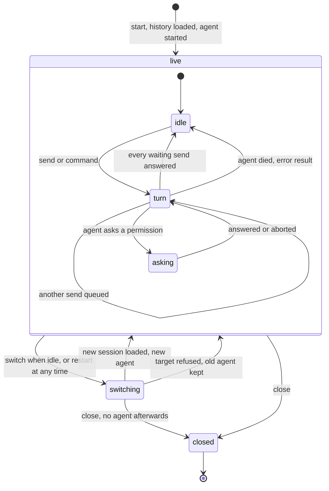
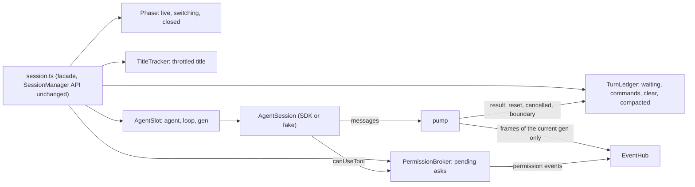

# M7 Architecture Hardening Implementation Plan

**Goal:** Act on the user's architecture review of 2026-10-27 (`docs/architecture.md` §8-9). A warm-up task and five packages, in document order:
- **M7-01 diagram tab:** a rendered diagram opens full size in an app tab.
- **A web structure:** UI persistence moves to listener middleware; three large components are split by composition.
- **E agent protocol:** our own `AgentEvent` stream (ACP-like) between the agent adapter and everything else; the SDK stays inside the Claude adapter.
- **B session state machine:** `SessionManager` gets explicit states and small single-purpose parts.
- **C history after compaction:** the replay starts at the last compaction; "Show before compaction" loads the earlier part on demand.
- **D one tab per window:** a second tab sees "window already open in another tab" and can take over.

**Architecture:** E changes the wire format (`{kind:'agent'}` replaces `{kind:'sdk'}`) but not what the user sees. A and B change no behaviour, proved by the existing tests plus characterization tests written first. C and D add protocol version 5 (`replay.earlier`, `GET /history`; `occupied`, `taken-over`, client message `takeover`, close code 4001) and sit on the session parts from B.

**Stack:** Node >= 23.6 TS (server, `ws`), React 19 + Redux Toolkit 2, vitest, Playwright.

**Spec:** `docs/architecture.md` §8 (risks) and §9 (the user's rulings). The user's words, 2026-10-27: on §8.2, a full system is needed or "everything will drift and a cloud of bugs appears"; on §8.4, limit the tool to one tab per session and the app should say another tab is open; on §8.5, do it right after compaction; on §8.6, go for composition at once; on §8.1, separate the agent SDK from the client/server API protocol, since other agents (GPT, GLM, DeepSeek) will need adapters on the server; and open a big diagram in a new app tab at full scale. The takeover and "show before compaction" designs were proposed in chat and accepted, as were package E before B and the diagram tab.

**Base:** worktree `nota-bene-m7`, branch `m7-architecture` from `main`.

## Constraints

M0-M6 rules hold (trailer `Task: M7-NN`; strings via `t()` in ru and en; ports 4790-4795 only; smoke follows CLAUDE.md hygiene; the persistence code in C gets an independent reviewer; check test exit codes directly, never through a pipe into grep).
- A and B are pure refactors: no test may change except imports and paths. A test that has to change in meaning is a finding, not a fix.
- The `SessionManager` type (`server/src/session.ts`) and its use in `server/src/server.ts` stay as they are through B; C and D may add members.
- A web change reaches the user after `npm run build -w web` and a reload; a server change needs "Restart the server" after the CLAUDE.md pre-check.

## Rulings

History (C):
- **R-M7-1.** The SDK cannot return the conversation before a compaction. Checked 2026-10-27 on a real transcript: 6 `compact_boundary` entries in the file, yet `getSessionMessages` returned 90 messages starting from the compaction summary, and no option of SDK 0.3.310 returns more. So we keep the earlier part: at each `compact_boundary` the server cuts the hub history before the boundary and appends it as one segment to its own archive `~/.nota-bene/history/<sessionId>.jsonl` (one line per segment `{"segment":n,"events":[...]}`); `stream_event` frames are dropped (a replay never needs them). Reading the CLI's `.jsonl` directly is rejected: it is a private format, the same risk as §8.1. Consequence: compactions done outside Nota Bene (plain CLI) have no archive and the button is not shown for them.
- **R-M7-2.** The cut keeps the `compact_boundary` frame itself, so the "compacted" marker stays the first item; the `/compact` user event before it goes to the archive.
- **R-M7-3.** `/clear` starts a new conversation id: the replay has `earlier: false`. The old id's archive stays on disk; switching back to that session offers it again.
- **R-M7-4.** "Show before compaction" loads one segment per click, newest first: `GET /history?session=<id>&before=<n>` gives `{events, segment, more}`. Before loading, a sent comment whose message is in an unloaded segment is labelled `srcBeforeCompact` in its card (not "orphan", no jump); after loading, the highlight resolves as usual.

One tab (D):
- **R-M7-5.** The server decides. The first socket is the owner. A later socket gets `{kind:'occupied'}` plus `hello`: no replay, no state frames, and its messages other than `takeover` are ignored. On `takeover` the server sends the owner `{kind:'taken-over'}`, closes it with code 4001, then attaches the new socket as on a normal connect.
- **R-M7-6.** Reload race: when a socket arrives while an owner exists, the server waits up to `TAKEOVER_GRACE_MS = 700` for the owner to close before answering `occupied` (a reloading tab's old socket closes in time in practice).
- **R-M7-7.** Zombie owner (sleep, dead network): the server pings every `HEARTBEAT_MS = 30_000` and terminates the owner if the previous ping got no pong. "Work here" works regardless.
- **R-M7-8.** The client stops reconnecting on close code 4001. The taken-over tab shows "Opened in another tab" and a "Work here" button (reconnects and sends `takeover` once `occupied` arrives); the occupied tab shows "Window already open in another tab" and the same button. One full-window overlay component; under it the app stays mounted but inert.
- **R-M7-9.** `startServer` gets `oneTab?: boolean`, default `true` (`main.ts` uses the default). Server unit tests that check broadcasting to several sockets pass `oneTab: false`. The e2e tests that open a second page (`e2e/comments.spec.ts:239`, `e2e/controls.spec.ts:106`, `:339`) become takeover flows or are rewritten to one page; assertions they lose are listed in the task report.
- **R-M7-10.** A protocol-4 page (cached old bundle) against a new server would show an empty app on `occupied`. Accepted: a reload fixes it.

State machine (B):
- **R-M7-11.** Parts under `server/src/session/`; `session.ts` stays the facade that wires them. `forkPending`, `sessionId`, `root`, `mode`, `model` stay in the facade.

| Part | File | Owns today's |
|---|---|---|
| `Phase` | `phase.ts` | `switching`, `closed` |
| `TurnLedger` | `turns.ts` | `waiting`, `commandIds`, `clearSent`, `clearResultDue`, `compactedInTurn` |
| `PermissionBroker` | `permissions.ts` | `pending`, `askFor` |
| `TitleTracker` | `title.ts` | `title`, `titleAt`, `titleTimer`, `fetchTitle`, `scheduleTitle` |
| `AgentSlot` | `agentSlot.ts` | `agent`, `loop`, `gen`, `ensureAgent`, teardown |

States the parts implement; `busy()` is true in `turn`, `asking` and `switching`:





- **R-M7-17.** The global activity is derived; each send is strict. `idle`, `turn`, `asking` are not stored states: `activity()` derives them from `TurnLedger` and `PermissionBroker`. Why: turns really overlap (queued sends, a forced send interrupting a running one, sub-agents asking several permissions at once); a single stored state would need the counters anyway, and two copies of the truth drift apart, the class of bug this milestone removes. Strictness moves to the entities: each send has its own state `queued -> running -> answered | cancelled | failed` and an illegal step throws (answering a send twice, running a cancelled one); each `PermissionBroker` ask is `open -> answered | aborted`; the global `Phase` stays strict because it is truly exclusive. Exception: a `turn-end` naming an id the ledger never saw (the CLI's synthetic turns, a send from before a restart) is ignored, as today.

Diagram tab (M7-01):
- **R-M7-12.** Every rendered diagram (mermaid or svg block, in chat, md files and comments) shows a hover button that opens one app tab per diagram, of kind `diagram`, holding source, language and title (first line of the source, up to 40 characters). Tab id `diagram:<8 hex of sha1(source)>`, so the same diagram reuses its tab. The view fits the pane; wheel or pinch zooms around the cursor (0.25x-8x), drag pans, a click toggles fit / 100%, `0` resets. The tab is persisted with the file tabs (source included) and re-rendered after a reload.

Agent protocol (E):
- **R-M7-13.** `AgentSession.messages` yields `AgentEvent` (`shared/src/agent.ts`), not `SDKMessage`. The SDK is imported only under `server/src/agent/claude/`. The fake backend emits SDK frames through the same Claude mapper, so e2e scripts and `real-frames.json` keep testing the real shapes.
- **R-M7-14.** The event set, named after ACP session updates so an ACP adapter is a thin mapping later:

```ts
export type StopReason = 'done' | 'interrupted' | 'failed';
export type AgentEvent =
  | { t: 'message-start' }                                   // streamed text block opens (ACP agent_message_chunk, first)
  | { t: 'message-chunk'; text: string }                     // ACP agent_message_chunk
  | { t: 'message'; id: string; text: string }               // final text of a block; id `${uuid}:${index}`
  | { t: 'tool-call'; id: string; name: string; input: Record<string, unknown>; sub: boolean } // ACP tool_call
  | { t: 'tool-update'; id: string; text: string; isError: boolean }                          // ACP tool_call_update
  | { t: 'turn-end'; stop: StopReason; secs: number; error?: string; answers: string[] | 'all' | 'none'; queued: number }
  | { t: 'cancelled'; sendId: string }
  | { t: 'compacting' } | { t: 'compact-failed'; error?: string } | { t: 'compacted'; preTokens: number; ms?: number }
  | { t: 'compact-end' }                                     // compaction ended with no boundary and no failure (hook-blocked, early start, retry)
  | { t: 'reset'; newId?: string }                           // /clear: a new conversation
  | { t: 'init'; sessionId?: string; model?: string; mode?: Mode }    // server-internal: never sent to clients
  | { t: 'mode'; mode: Mode }                                // ACP current_mode_update
  | { t: 'task'; id: string; phase: 'started' | 'progress' | 'updated' | 'done'; desc?: string; type?: string; tokens?: number; tool?: string; summary?: string }
  | { t: 'suggestion'; text: string }
  | { t: 'rate-limit'; info: unknown };                      // server-internal (stats)
```
  Wire event: `{kind:'agent'; e: AgentEvent; ts: number}` replaces `{kind:'sdk'}`; `init` and `rate-limit` are never sent to clients. The web keeps `forcePending`: any `turn-end` while a forced send is pending shows as interrupted with no error text (as `feed.ts` does today). Amended 2026-10-27 (M7-06 review): `compact-end` added, because the CLI sends a bare `status: null` with no boundary in three cases (a PreCompact hook blocks it, an early-started auto-compaction ends with no result, the prompt-too-long retry) and today that clears the compacting banner; mapping it to `compact-failed` would show a false failure.
- **R-M7-15.** `AgentBackend.capabilities = {compact, clear, modes: Mode[], usage, fileSuggestions, fork, idleCompact}` (booleans except `modes`), sent in `hello`. The UI hides a control whose capability is false. Claude has all true; the fake mirrors Claude unless its script says otherwise.
- **R-M7-16.** Not in M7: other models on the same agent (DeepSeek's Anthropic-compatible endpoint, likely GLM) need no adapter, only a per-window `ANTHROPIC_BASE_URL` setting (a later task). Other agents (Codex, Gemini CLI, OpenCode) come later through one ACP adapter. Adapters to bare model APIs are rejected: they would mean writing our own agent loop.

## Review focus (each has a test)

1. The owning tab is reloaded: it returns as owner without the overlay flashing (M7-15; e2e reloads twice, expects no overlay).
2. A compaction in the middle of a live turn (auto-compact, idle compaction): frames after the boundary stay in the replay; `busy` and `waiting` unaffected (M7-12).
3. A sent comment on a message that went into the archive does not read as orphaned or deleted (M7-13).
4. A takeover during a switch or a turn: ownership is independent of the session; the new tab gets the current replay and the switching and busy state (M7-14).
5. Server restart after a compaction: the replay comes from the transcript (post-compaction) and `earlier` is true when the archive has segments for that id (M7-12).

## Tasks

- **M7-01 Diagram tab (R-M7-12).** Files: `web/src/tabs/slice.ts` (`DiagramTab` kind, `openDiagram({source, lang})`, persisted in `SavedTabs`), `Panes.tsx`, `TabStrip.tsx` (icon), `web/src/feed/Markdown.tsx` (button on `.mermaid-out` / `.svg-out`); new `web/src/diagram/DiagramView.tsx` (same mermaid loader and DOMPurify path as `Markdown.tsx`, then fit/zoom/pan) and `zoom.ts` (pure: fit scale, zoom around a point, clamps). i18n `openDiagram`, `diagramTab`. Tests: zoom (fit, clamp 0.25-8, point under the cursor stays put), DiagramView, slice (same source reuses its tab; reload restores it), an e2e step in `e2e/chat.spec.ts`.
- **M7-02 UI persistence on listener middleware (§8.3).** New `web/src/store/persist.ts` with `persistListeners(lm)`, registered in `makeStore` on its own listener middleware (next to `controlsListener`); the `store.subscribe` block in `store.ts` is removed. One listener per concern, each with a `predicate` comparing `original` with current state: `panel:comments`, `panel:tree`, `tree:<root>[:<src>]` dirs, `tabs:<root>`, the recent-file dwell (`RECENT_DWELL_MS`, cancelled by the next active change via `cancelActiveListeners`), and the root change (on `serverEvent` `session` with a root different from `tabs.root`: `clearRefCache` (not on the first root), `loadSources(!first)`, then `enterRoot` with the saved tabs and dirs read before the dispatch). No `store.subscribe` may remain; no test file edited.
- **M7-03 FileTree by composition (§8.6).** Split into `web/src/files/tree/{useTreeEntries.ts (entries, loading, failed, track, merged refresh, missedTurn, shownIn), useExpandAll.ts (BFS, EXPAND_CAP, EXPAND_FETCHES, NO_EXPAND), TreeHeader.tsx, TreeRow.tsx}`; `FileTree.tsx` becomes composition only; `FileTree` and `EXPAND_CAP` keep their exports and paths; no file over 200 lines; move code, no logic edits, no test edited.
- **M7-04 FileView by composition.** `web/src/files/view/{useFileLoad.ts (HEAD / Range probe / GET sequence, rev, bust, failed, reloadMedia, version dispatch), useMediaMarkup.ts (markable, markPopup, onMarkAdd, markAdded, saving), CodeText.tsx, TextBody.tsx, MediaBody.tsx}`; same rules as M7-03.
- **M7-05 CommentCard by composition.** `web/src/comments/card/{useCommentSource.ts (sourceState, orphan detection, itemRoot/fileRoot), CardActions.tsx (IconButton and action row), CommentCardPopover.tsx (with usePopoverPlacement)}`; same rules.
- **M7-06 `AgentEvent` and the Claude mapper.** `shared/src/agent.ts` (R-M7-14 verbatim); `server/src/agent/claude/map.ts` with pure `mapSdk(m): AgentEvent[]` (one SDK frame gives zero or more events) and a test for every frame type in `server/test/fixtures/real-frames.json`; `sdk.ts` and `transcript.ts` move under `server/src/agent/claude/`. Mapping follows today's `web/src/store/feed.ts` `reduceSdk`, `web/src/tasks/slice.ts`, the suggestion in `web/src/controls/slice.ts`, and what `session.ts` `pump` and `stats.ts` `onSdk` read. `turn-end`: `stop` is `interrupted` when `terminal_reason` starts with `aborted` or for `error_during_execution` without `is_error`, else `failed` when `is_error` or a non-success subtype, else `done`; `error` from `result` or `errors[]`; `answers` = `user_message_uuids` (or `user_message_uuid`), else `'all'` when `is_error`, else `'none'`; `queued = queued_turn_count ?? 0`.
- **M7-07 Server on `AgentEvent`.** `agent/types.ts` (`messages: AsyncIterable<AgentEvent>`, `history()` builds `ServerEvent[]` from `AgentEvent`, `capabilities`), `claude/sdk.ts` (maps with `mapSdk`), `claude/transcript.ts` (emits `message`, `tool-call`, `tool-update`, `user`), `fake.ts` (its SDK frames pass through `mapSdk`), `session.ts` (`pump` reads `AgentEvent`, emits `{kind:'agent'}`, never emits `init`/`rate-limit`), `stats.ts` (`onAgent(e)`), `shared/src/protocol.ts` (`{kind:'agent'}` replaces `{kind:'sdk'}`, `PROTOCOL = 5`), and the server tests that assert `kind:'sdk'`. Rule: `grep -rn "claude-agent-sdk" server/src` lists only files under `server/src/agent/claude/`. Between M7-07 and M7-08 the branch's e2e is red (server speaks the new protocol before the web); unit tests stay green per task.
- **M7-08 Web on `AgentEvent`.** `feed.ts` (`reduceAgent` replaces `reduceSdk`; the loose `Sdk` type is removed), `tasks/slice.ts`, `controls/slice.ts`, `store.ts` (`compactTimingMiddleware` reads `compacted.ms`); web test frames rewritten as `AgentEvent`s, each keeping its assertion. e2e is green again.
- **M7-17 Comments on agent actions (runs right after M7-08).** The user, 2026-10-27, wants folded agent and subagent actions still visible and commentable (view and comment a command, script or action). Folding ("N actions", collapsed, latest live) landed on `main` as 6d81603 or later; first step is to merge `main` into `m7-architecture`.
  - **R-M7-18.** The tool panel's command and output become anchorable text with source `{kind:'message', id:'tool:<tool_use_id>'}` (tool_use ids are stable across replay and restart, so no protocol change); the toggle line stays out of anchors (`data-anchor-skip`).
  - **R-M7-19.** Open state of groups and tool panels moves to a small non-persisted slice `feedUi: {openTools: string[]; openGroups: string[]}` (new `web/src/feed/uiSlice.ts`), so a jump from a comment card can open the group and the panel.
  - **R-M7-20.** The batch names the place as `t('srcTool', name, arg)` ("Bash command (npm test)", `arg` cut to 60 characters). A collapsed group whose actions carry comments shows `nComments` on its head, so a comment is never hidden.
  - Files: `ToolLine.tsx`, `ToolGroup.tsx`, `store.ts` (`selectReplyLabel` for `tool:` ids), `HighlightLayer.tsx`, `card/useCommentSource.ts` (find and jump to `tool:` roots), `SelectionButton.tsx` (selection inside a tool panel). Tests: a comment on a tool's output anchors to `tool:<id>`, the batch line names it, a collapsed group shows the count, a jump opens group and panel and highlights; e2e: comment a command's output, reload, highlight is back.
- **M7-09 Capabilities (R-M7-15).** `hello.capabilities` in `protocol.ts` and `server.ts`; the web hides Compact/Clear, ModePill, the idle toggle, usage meters and session-picker fork per capability (`MentionPicker`: fileSuggestions only changes the source, the own index stays). Test: a fake script with `"capabilities": {"compact": false, "modes": ["default"]}` hides Compact and the mode pill (unit and one e2e).
- **M7-10 Characterization tests for SessionManager.** `server/src/session.characterization.test.ts`, against the fake backend and unchanged code, one test per scenario not already pinned by `session.test.ts`, `switch.test.ts`, `commands.test.ts` (the report lists the existing or new test per scenario): (1) a send during a switch returns `'switching'`, nothing emitted; (2) a switch while a send waits is refused with `SwitchError('switch')`, a restart while it waits interrupts then resumes the same id; (3) a permission asked by the old agent after `gen++` resolves `false` and is never emitted; (4) `/clear`: the reset empties the hub, the following result is not stored, the new id is saved, id listeners get `(new, old)`; (5) a `/compact` result never arms idle compaction, a normal turn's result does, a turn containing `compact_boundary` does not; (6) `command_lifecycle` `cancelled` drops that id from `waiting`; (7) the agent's loop ends without close: an error result answers every waiting send and `busy()` is false; (8) a fork never writes the source id to `sessions.json` before the first init names the new id, and a restart before that init keeps forking; (9) `setMode` during a switch answers with the current mode and its ack without applying; (10) `close()` during a switch starts no agent afterwards; (11) a forced send interrupts first then sends with priority `'now'`, two sends keep order; (12) a title lookup answering after a switch is dropped.
- **M7-11 Explicit state machine (R-M7-11, R-M7-17).** New `server/src/session/{phase,turns,permissions,title,agentSlot}.ts`, each with its own test written first; `session.ts` becomes the facade (at most 350 lines). `activity(): 'idle'|'turn'|'asking'` is derived; `busy()` = `phase.kind === 'switching' || turns.waiting() > 0 || permissions.pending() > 0`. An illegal transition throws, and is a test failure, never caught silently. M7-10's file stays unchanged and green; independent review on the most capable model (the diff plus the M7-10 scenarios mapped to the new code). Interfaces (exact; later tasks use them):
```ts
Phase { kind: 'live'|'switching'|'closed'; beginSwitch(): boolean /* live->switching; throws SwitchError('switch','a switch is already in progress') when switching; false when closed */; endSwitch(); close() /* final */ }
TurnLedger { sent(id, {command?: 'compact'|'clear'}?) /* queued; throws if id known */; running(id) /* queued->running only */; state(id): SendState|undefined;
  turnEnd(e: turn-end): {store: boolean; arm: boolean} /* store false for a /clear's own result; arm = idle compaction should arm */;
  cancelled(id); compactBoundary(); reset() /* clears waiting; next result is a /clear's own if one was sent */; userTurn(); waiting(): number; clear() }
  // SendState = 'queued'|'running'|'answered'|'cancelled'|'failed'
PermissionBroker({emit}) { ask(gen: () => number, g): PermissionAsk; answer(id, allow); pending(): number; denyAll() }
TitleTracker({lookup, onChange}) { title; afterResult(id, dir, gen, currentGen); load(id, dir); reset(); stop() }
AgentSlot({start: (g) => AgentSession, pump}) { gen; agent; isCurrent(a, g); ensure(phaseLive: boolean) /* throws when not live */; teardown(waitMs) /* gen++, close, wait for loop */; died(a) }
```
- **M7-12 Server archive and `/history` (R-M7-1..4).** New `server/src/archive.ts`; `hub.ts` gets `cut()` (removes and returns the history before the last stored `compacted` agent event; the event stays) and `reset(events, {earlier?})`/connect replay carry `earlier` (archived segment count) when > 0; `session.ts` cuts at `compact_boundary`; `PROTOCOL = 5` and `replay.earlier?: number`; `system.ts` counts `history/` in storage size and its clean action removes archives whose transcript is gone. `HistoryArchive({dir})`: `append(sessionId, events): number` (new segment number from 1; drops `message-start` and `message-chunk`; one fsync'd line per segment), `count(sessionId)`, `segment(sessionId, n): ServerEvent[] | null`; ids are checked against the session-id pattern; a corrupt line is skipped and reported once. `GET /history?session=<id>&before=<n>` returns `200 {events, segment, more}` for segment `n-1`; 404 when none; 409 when `session` is not the current id (only the current session's archive is served). Tests: cut keeps the boundary and later frames; a compaction mid-turn keeps waiting and busy; stream_event frames are not archived; restart after a compaction replays the transcript with `earlier = count`; `/clear` replays with no earlier; history 409 for another session; corrupt line skipped. Independent review (persistence).
- **M7-13 "Show before compaction" in the feed (R-M7-4).** `feed.ts`: `earlier: number` in `FeedState` from `replay.earlier`; action `historyPrepended({events, segment, more})` reduces `events` from `emptyFeed` and prepends the items. New `web/src/feed/EarlierButton.tsx` (first feed item when `earlier > 0`; loading and error states; strings `earlierShow`, `earlierLoading`, `earlierFailed`, `srcBeforeCompact` "before compaction"). `card/useCommentSource.ts`: a sent comment whose message is absent while `earlier > 0` shows `srcBeforeCompact`, no jump. Tests: `historyPrepended keeps live state`, EarlierButton, card.
- **M7-14 Server ownership and takeover (R-M7-5..7, R-M7-9).** `server.ts` (owner, grace, heartbeat, `takeover`), `protocol.ts` (`occupied`, `taken-over`, `takeover`), multi-socket server tests pass `oneTab: false`; new `server/src/onetab.test.ts`: second socket gets occupied and no replay; an occupied socket's send is ignored; takeover closes the owner with 4001 and replays to the new one; owner closing within the grace makes the newcomer the owner; owner with no pong is terminated; takeover during a turn shows the turn running; `/info.clients` counts the owner only.
- **M7-15 Occupied and taken-over screens (R-M7-8).** `web/src/net/socket.ts` (no reconnect after 4001; `reconnect()` export); `store.ts` (`ConnState` gains `'occupied' | 'taken'`, thunk `takeOver()`); new `web/src/shell/OneTab.tsx` (strings `occupiedTitle` "Окно уже открыто в другой вкладке", `takenTitle` "Открыто в другой вкладке", `workHere` "Работать здесь", plus en); the e2e specs named in R-M7-9 adjusted; new `e2e/onetab.spec.ts` (second page sees the overlay; "Work here" moves the session; the first page shows taken; a double reload of the owner shows no overlay).
- **M7-16 Final review, merge and smoke.** Whole-branch review on the most capable model, fix findings with a scoped re-review; fast-forward `main`; `npm run build -w web`; CLAUDE.md pre-check, then ask the user for "Restart the server" and verify the pid changed. Smoke with the user: a second tab and "Work here"; a reload of the owner; `/compact`, reload, "Show before compaction"; a server restart after a compaction. Update `docs/architecture.md` §3-§5 and §8, and `CLAUDE.md` (state dir `history/`, the `/history` route, one tab per window).

Every task: red, then green; `npm test` (and `npm run e2e` where the web or protocol changed) exit 0; `npx tsc -b` exit 0; one commit with `Task: M7-NN`.
