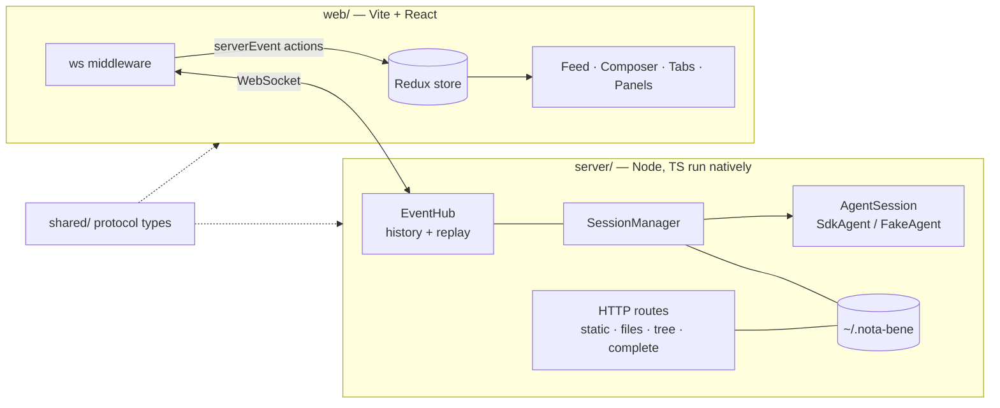

# Nota Bene rebuild — design

Status: draft for review · 2026-10-24. Source of truth for features: `prototype/` (working spike).

## Goal

Rebuild the prototype as a maintainable React + TypeScript app with feature parity, switch daily use over, then retire `prototype/`. No new features until parity, except three that fix structural problems (stable comment anchors, in-process session switching, state directory outside the repo) and one added by decision (2026-10-25): subagents and background tasks.

Non-goals until parity: annotations on media; multi-user/auth/remote (server binds `127.0.0.1`); desktop packaging; replacing the Claude Code CLI (the agent stays the CLI, driven through the Agent SDK).

## Architecture



- npm workspaces: `shared/` (protocol types, pure helpers), `server/`, `web/`.
- Server runs TypeScript natively (Node >= 23.6 strips types): no build step, `erasableSyntaxOnly: true` (no enums, namespaces, parameter properties).
- web: Vite, React, Tailwind 4, shadcn/ui, Redux Toolkit. Markdown stays marked + DOMPurify + highlight.js + mermaid in one memoised `<Markdown>`.
- Redux Toolkit chosen because the app is event-sourced: every server event enters as one action `serverEvent(ev)`; slices are pure reducers. DevTools gives a replayable log of what the server sent (the main debugging need: streaming, replay, mid-turn races). Slices: `feed`, `conn`, `comments`, `tasks`, `tabs`, `session`/`stats`/`mode`. The WebSocket lives in a middleware; components use typed selectors only.
- `AgentSession` interface: `SdkAgent` wraps `query()`; `FakeAgent` replays scripted events and powers every automated test (deterministic, no tokens).
- `SessionManager` owns the current `AgentSession`. Switching session/folder is `close()` plus a new session in-process; no exit-75 restart (needed only when server code changes).

## State directory

`~/.nota-bene/` (override `NOTA_BENE_HOME`), so the repo stays clean.

| File | Content |
|---|---|
| `sessions.json` | last session id per project dir |
| `windows.json` | running servers `{port, pid, root, startedAt}`; stale entries pruned by pid |
| `comments/<sessionId>.json` | pending and sent comments |
| `prefs.json` | permission mode per project dir, UI language |

`windows.json` replaces HTTP port probing, which raced with restarts and could open a second window on one folder.

## Comment anchors (key decision)

The prototype kept live DOM `Range`s; React re-renders break them and reloads lose comments. Comments are stored as text anchors (W3C TextPosition + TextQuote):

```ts
type AnchorSource = { kind: 'message'; id: string } | { kind: 'file'; path: string };
type Anchor = { source: AnchorSource; start: number; end: number; quote: string; prefix: string; suffix: string }; // context up to 32 chars
```

- Rendered text = container text content, whitespace normalised. `textOf(root)` and `rangeFromOffsets(root,start,end)` in `web/src/anchors/` are the only code touching DOM ranges.
- Resolve: slice `start..end` equals `quote` -> done; else search `quote`, score hits by prefix/suffix; else the comment is orphaned (kept in the panel with its quote, nothing highlighted).
- Stable ids: user messages get a client `uuid` sent as `SDKUserMessage.uuid`; assistant block id is `${assistant.uuid}:${blockIndex}`; a streaming block cannot be commented until final.
- Server stores `comments/<sessionId>.json`; survives reloads, restarts, resumes; sent comments keep dimmed marks.

## Agents and background tasks (decided 2026-10-25)

- Source of truth: SDK task events (`task_started`, `task_updated`, `task_progress`, `task_notification`, `background_tasks_changed`) drive a `tasks` slice keyed by `task_id`. Options on: `forwardSubagentText` (tagged `parent_tool_use_id`), `agentProgressSummaries`.
- UI: an indicator under the composer shows the running count; click opens a bottom drawer (overlay) with the task tree and actions. Chosen over a third side sheet because tasks are live activity tied to the current turn and must be visible next to the composer; side sheets hold browsable content.
- A subagent opens as a tab with its own feed (same reducer, filtered by `tool_use_id`); a shell task opens as a tab with its output tail, polled every second while visible. Agent tabs are commentable.
- Prompting subagents is out of scope: comments on a subagent chat go to the main session, labelled with the subagent and reply.
- Control: stop (`{type:'task-stop', id}`), background (`{type:'task-background', toolUseId}`, Ctrl+B). Output is `GET /task-output` (polled read-only tail like `/subagent`, protocol 8), not a socket message.
- Resume: on `--continue`, `listSubagents` + `getSubagentMessages` restore subagent chats.
- Tabs: main chat is the first tab, never closed. Right-click menu (VS Code/IntelliJ style): Close, Close Others, Close to the Right, Close All. The `tabs` slice is reused by files.
- Parked: messaging a running agent (agent teams).

## Protocol

JSON over one WebSocket, types in `shared/src/protocol.ts`; SDK message types imported, not redefined.

- Server -> client: `replay {events}` (on connect), `sdk {m}`, `user {id,text,comments,images}`, `permission {id,toolName,input}`, `permission-done {id,allow}`, `stats`, `mode {mode}`, `session {id,root,title}`, `server-error {where,message}`.
- Client -> server: `send {id,text,comments,images,force}`, `interrupt`, `permission {id,allow}`, `command {name:'clear'|'compact'}`, `mode {mode}`, `switch {sessionId|null,dir}`, `comments {sessionId,items}`.
- `parseClientMessage()` validates every inbound message; invalid input becomes `server-error`, never a crash.

## Error policy

- One wrapper for every HTTP route: a thrown error returns 500 plus a `server-error` toast.
- `uncaughtException`/`unhandledRejection` are reported, not fatal. File streams handle `error`.
- Range parsing follows RFC 9110; an unsatisfiable range returns 416, never throws (the prototype's crash).

## Parity checklist (milestone in brackets; all delivered except the last M4 item)

**Chat (M0):** streaming markdown with highlighting, mermaid, svg; mid-turn injection (`priority:'next'`), Cmd+Enter interrupt-and-send (`'now'`), Stop/Esc; tool lines (subagent indented, errors red); expandable tool lines (input and output, also after reload/resume; added 2026-10-25, delivered in M1); done line with duration; permission cards (moved from M4, the real agent stalls without them); transcript replay on reconnect/resume (`getSessionMessages`); i18n ru/en via `t()` from day one; Plannotator palette and chrome.

**Comments (M1):** select text in a reply, own message or open file -> Comment popup (Cmd/Ctrl+Enter adds, Esc cancels); pending marks yellow, sent marks dimmed purple; click mark -> card popup with edit/delete; side panel stack with jump-to-source and count badges; batch send (fragments + comments + image refs); anchors persist, orphans shown not dropped; quick labels (Plannotator-style, one click, translated, each may carry a hidden agent instruction sent with the batch): Looks good, Clarify this, Verify this, Give me an example, Missing overview, Match existing patterns, Consider alternatives, Ensure no regression, Out of scope, Needs tests; emoji menu and `:` shortcodes with autocomplete (same keyboard behaviour as the `@` picker).

**Agents & tasks (M2):** indicator under composer (Alt+T; finished tasks stay, last 20, shown as `✓ N`); drawer tree (subagents, shell, monitors, nested by `parent_task_id`) with status, elapsed, tokens, last tool, summary, actions open/stop/background; subagent chat tab; shell output tab; subagent call as a card in the main feed; resume of subagent chats; tab strip and context menu (delivered in M3; main chat pinned, Close Others/Close All only on it; file tabs add Copy Path and Reveal in File Tree; middle click closes; closing a media tab stops it and closes PiP).

**Files & media (M3):** file tree sheet (overlay, filter, refresh keeping open folders, auto-refresh after live turns); file tabs md/code/image/video/audio with HTTP Range; PiP when leaving a playing video, audio keeps playing, ▶ dot on tab; clickable project paths (HEAD check, strike-through if missing); `@` mentions (CLI `file_suggestions` with own fuzzy fallback, quoted paths with spaces); image attachments (paste/drop/📎, downscale <= 1568px, png->jpeg over 3.5 MB, thumbnails, lightbox); attachments stored by content hash (`~/.nota-bene/attachments/<sha256>.<ext>`) and sent as ids, never base64 in replay; comments on open files; branches and worktrees (requested 2026-10-25): the window's checkout is never switched; tree has a source selector (this checkout, other worktrees via `git worktree list`, local branches without a worktree read by `git ls-tree`/`git show`); other sources open read-only in tabs marked with the branch, commentable (anchor carries the ref); agent-printed paths inside another worktree open from it.

**Session & agent controls (M4):** session picker over all folders (grouped by cwd, filter, in-process switch); `cwd` read from transcript head when `listSessions` omits it; tab/document title = session title; footer meters (context via `getContextUsage`, plan limits 5h/week via usage API with `rate_limit_event` fallback, cost fallback); compact and clear (`conversation_reset` clears feed); plan card for `ExitPlanMode`; mode pill/menu (default, acceptEdits, plan, auto), Shift+Tab, follows CLI mode changes, persisted; prompt suggestions as ghost placeholder (Tab accepts); favicon by state (idle purple, working blinking, waiting red, done-while-away green); error toasts deduped; `--chrome` enabled; ↻ restarts the agent in-process and resumes (works while busy). Open: background-task line above composer (superseded by the M2 indicator).

**Launch (M5):** `nota-bene [dir] [--port] [--resume id [--fork]] [--new]` resumes the folder's last session; `/nb` skill (`new`, `fork`) via `windows.json`, never a second window per folder; dev mode (Vite HMR + server watch) on its own port; prototype retired.

## Milestones

Each gets its own plan in `docs/superpowers/plans/` and ends usable: M0 Foundation (workspaces, protocol, agent, hub, server, shell, feed, composer, i18n, e2e); M1 Comments; M3 Files & media (incl. tabs, branches/worktrees read-only); M4 Controls; M5 Launch; M2 Agents & tasks.

Order (decided 2026-10-25): M3 -> M4 -> M5 -> M2. Switching from the prototype needs full parity; M2 is beyond the prototype, so it comes after. Tab strip and menu moved from M2 into M3 because file tabs need them. Feature freeze on `prototype/` except bug fixes.

## Testing and risks

- Vitest for shared/server units and web logic (reducer, anchors, i18n, Range, fuzzy). Playwright e2e against the server with `--fake <script>`. Manual real-SDK smoke at each milestone on port 4790 with a temp project, never on a live window.
- Risks: selection/popup/focus details (most prototype bugs; e2e covers every keyboard path); SDK internal `request()` for `file_suggestions` may change (fallback mandatory and tested); 100MB+ transcripts (out of scope; anchors are virtualisation-safe).

## Follow-ups from daily use

- System menu of every running window (2026-10-26, after an orphaned prototype server held port 4777 for two days): from launcher registry `~/.nota-bene/windows/` plus `/info` per port and a 4777-4799 scan for prototype windows. Rows: folder, title, port, uptime, headless (zero sockets), busy. Actions: open, restart agent/server, stop (confirmed; refuses the current window). Ships after the switch, next to M2.
- Media/PiP loop (prototype bug): media tab -> another media tab never uses PiP, the previous pauses; PiP only when leaving a playing video for a non-media tab, at most one PiP window; PiP "back to tab" only activates the tab. e2e: play A, open B, open C -> one video plays, no PiP, no repeated focus events. Confirmed 2026-10-25: all media equal (opening one pauses others, background audio included); never autoplay (`preload=metadata`).
- Idle compaction (shipped 2026-10-26): the CLI compacts a quiet 200k+ conversation before its 1 h cache expires; the SDK does not. Server does it 50 min after the last turn, only if the window was inactive 15 min, context >= 200k, cache still warm (55 min). Default on; per-project clock toggle next to ⇣; `"idleCompaction": false` in settings.json blocks it.
- Tool-wide journal (idea, 2026-10-26): Nota Bene's own cross-project session journal, independent of any personal note setup; possibly fed to the agent after compaction; must not duplicate CLAUDE.md/memory. Design separately.
