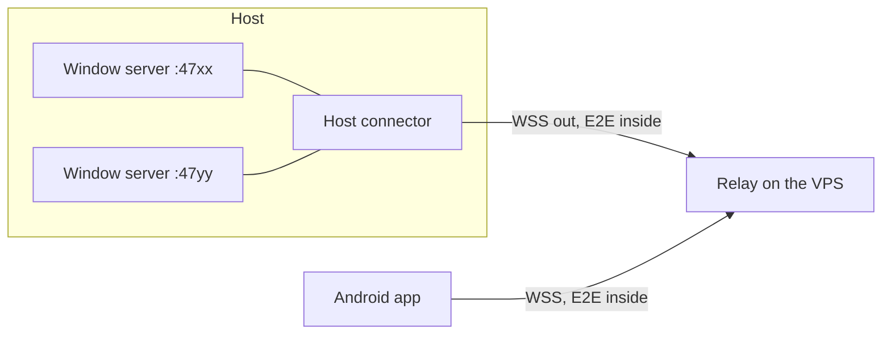

# Remote control prototype: sessions from a phone over a relay

Issue #63 holds the agreed direction for remote access. This document narrows it to a first prototype that the
author can use for real: the host (a laptop at home, on its own network) keeps running the windows and the agents;
the author is out, on mobile data, with an Android phone, and continues the work.

## Intent

Two moments the prototype must serve end to end:

1. **Text work.** Open the current chat with the agent, read what it did, answer its question or approve a command,
   open the spec or plan it wrote, comment on passages, and send the next message so the work continues.
2. **Media work.** Open an image or a video of the project, mark a region or a point (image) or a moment (video),
   comment on it, and send it to the agent.

Success: the author does both from a mobile network, against a real session at home, without wishing they were at
the laptop.

## Goals, non-goals, anti-goals

Goals:

- An Android app (Flutter) that reaches the host only through a relay; nothing listens on the host.
- End-to-end encryption between host and phone from day one; the relay sees only ciphertext and routing ids.
- Pairing by a QR code shown on the host.
- In the app: the session list, the chat, approvals and agent questions, stop the turn, compact, switch model,
  restart the agent, usage statistics, Markdown files with text comments, images and videos with markup comments,
  dictation instead of typing.
- A relay the author deploys on a small VPS (1 vCPU, 512 MB, Ubuntu) from a script in the repository.

Non-goals (later, mostly as #63 lists them): push notifications; iOS; Windows hosts; a short typed pairing code
with PAKE (the QR replaces it for now); file editing, Changes, Git log, terminal and `!` commands; 3D models and
HTML pages on the phone; a desktop client over the relay (phase 2); hosted relays for other people.

Anti-goals: a relay that stores, queues or logs content; anything on the host that accepts inbound connections;
a phone that can do something the host's owner did not pair it for; a homemade cipher or handshake; a second
comment flow that differs from the desktop's; desktop features lost or changed by this work.

## Constraints

- Hosts: macOS and Linux, as today. Phone: Android. The relay: Linux amd64, a 512 MB droplet.
- `main` rules stand: issues, squash-merged PRs, CI green, tests on ports 4790–4795, every UI language for every
  user-visible string. This applies to the Flutter app too (six languages, as `LANGS`).
- The window servers' security model (section 6 of `docs/architecture.md`) does not loosen: servers keep listening
  on 127.0.0.1 only, and the token stays on the host.
- Public repository: neutral fixtures, no personal hosts, domains or keys in tracked files.

## Decisions

### Shape

- **Host connector.** One long-running process per host user (`nota-bene remote`, a new launcher command, code in
  `server/src/remote/`). It reads the window registries (`~/.nota-bene/windows/`, the Codex registry under
  `providers/codex/`), reaches each window server on 127.0.0.1 the way the existing helpers do (the `/hello` proof,
  then the helper bearer), and keeps one outgoing WebSocket to the relay. It is the only new thing that touches
  window servers; the servers themselves change only where a feature needs it.
- **Relay.** A Go service in `relay/` (its own Go module): one static binary, TLS by autocert (Let's Encrypt) on
  443, run by systemd. It pairs a host stream with device streams by host id and forwards bytes. No disk writes
  beyond the certificate cache, no content in logs, nothing queued while a side is away.
- **App.** Flutter in `mobile/`, distributed as an APK the author installs by hand. No store, no developer account.

### Identity, pairing and the channel

- The host connector and every phone hold a long-term X25519 key pair (host: a file under `~/.nota-bene/remote/`,
  mode 600, same rules as the token; phone: Android Keystore-backed storage).
- **Pairing.** `nota-bene remote pair` (and later a Settings button) shows a QR code with: the relay URL, the host
  id, the host's public key and a one-time 256-bit pairing secret valid for a few minutes. The phone scans it,
  connects, and proves knowledge of the secret while sending its public key; the host adds the device to its
  device list and consumes the secret. The host prints both key fingerprints so they can be compared.
- **The channel.** Each phone connection runs a standard authenticated handshake with both static keys pinned
  (Noise IK or XX over 25519 / ChaChaPoly is the expected choice; the builder picks a maintained implementation on
  each side and records it). Fresh session keys per connection.
- **The relay's own gate.** When the host connector connects it proves possession of the host key and hands the
  relay, in memory only, the hashes of its paired device keys; the relay drops device connections that do not
  present one. This is only a filter against noise: the handshake is the real gate.
- **The pairing state machine** (my call): one pairing in flight at a time; a new `pair` cancels the previous code;
  the secret is consumed by the first successful proof, and any later presenter is refused and announced on the
  host.
- **Revoking** in the prototype: `nota-bene remote devices` lists, `nota-bene remote revoke <id>` removes; the
  connector drops that device's live connection at once.
- **Commands and the running connector** (my call): the device list is a file under `~/.nota-bene/remote/` (mode
  600) and the source of truth; `pair`, `devices` and `revoke` talk to the running connector over a Unix socket in
  the same folder (mode 600), and the connector updates the relay's in-memory filter live.

### What goes through the channel

The app speaks the window servers' existing protocol. Inside one encrypted channel, frames carry multiplexed
streams:

- a WebSocket stream to a chosen window's `/ws` (the app is a tab of that window);
- HTTP request/response streams to that window's routes (`/file` with Range, `/marks`, `/usage`, `/sessions`, …);
- a host-level stream for the session list (windows, provider, project, status) and the host's online state.

The connector adds the credentials; the phone never holds a window's key or cookie. The protocol types come from
`shared/src/protocol.ts` through a JSON Schema generated from it, and the Dart types are generated from that
schema, so the two cannot drift silently; generation runs in CI and fails on a stale output.

Video: the app runs a local loopback HTTP endpoint that serves the player from the channel, Range included.

Flow control (my call): every stream has a credit window, so a slow phone throttles the host instead of filling
buffers; the relay holds a small bounded buffer per connection (on the order of 1 MB) and applies backpressure
rather than buffering more. File size then costs mobile data, not memory on the droplet. No transcoding in the
prototype; if traffic or speed on mobile data become a problem, the next step is a compressed preview made on
the host (ffmpeg) for the phone.

Schema source (my call): `protocol.ts` is not restructured. The schema is generated from its existing types
(ts-json-schema-generator or similar) for the messages the app uses; where a type does not convert cleanly, that
part of the schema is written by hand and a test checks it against the TypeScript parser's fixtures.

### The app

The sketches in the brainstorm (screens A–G) are the reference. Decided with the author:

- **Start screen:** the chat opened last on this device; if there is none or its host is offline, the session
  list grouped by host (one host in the prototype, the layout ready for several).
- **Navigation:** a stack from the chat. Files open over it from the cards in the feed and from the chat's menu
  (recent files of the session); back returns to the chat.
- **Comments accumulate** above the composer and leave with the next message, as on the desktop: the same batch,
  the same anchors (text anchors on Markdown, media anchors with a region/point or a time), the same quick labels
  (`web/src/comments/labels.ts`: emoji, label text, the English instruction sent to the agent). The comment sheet
  is a full-width bottom sheet: the quoted selection, the quick labels in a horizontal row, a multi-line field.
- **Approvals** are a bottom sheet over the chat with the full command in monospace; questions are answered in
  the feed.
- **Controls:** stop the turn, compact, switch model (and effort), restart the agent, usage statistics.
- **Dictation:** a microphone button in the composer and in the comment sheet turns speech into text with the
  phone's own speech recognition (Android `SpeechRecognizer`, in the UI language); the text lands in the field and
  is edited and sent as typed text. No audio leaves the phone through Nota Bene and the agent gets text only (my
  call: agents do not take audio, and a transcriber on the host would be a much larger piece).
- **Rendering:** Markdown, code highlighting, KaTeX through a Dart port (`flutter_math_fork` family), Mermaid through
  a native renderer (`mermaid_flutter` or `merman`), checked against the diagrams the project's agents actually
  produce; a WebView only as the fallback for diagrams those cannot draw.
- **Host offline:** a status line with the last-seen time; what already arrived stays readable; sending is
  disabled, not deferred.
- **Look:** the Nota Bene themes' tokens; Darcula first.
- **Window ownership** (the author's decision): the phone is an ordinary tab of that window (`/ws?tab=<id>`), and
  the existing one-tab rule applies: it shows "already open in another tab" with "Work here", which takes the
  window over; the desktop tab then offers to take it back. No new mode and no protocol change for this. Mirrored
  live tabs were considered and dropped as too heavy for now.
- **App strings** (my call): Flutter's ARB files, one per language of `LANGS`; a test fails when the files' keys
  differ. The quick labels' texts are generated from `web/src/i18n` so the two clients cannot drift.

### Trust of a paired phone

A paired phone is fully trusted (the author's decision): the channel carries the window's whole protocol, not an
allowlist, and later app features need no connector change. Because of that the app opens only after the phone's
biometric or PIN check (Android BiometricPrompt), and a revoke on the host cuts a lost phone off at once (my call).

### Deployment

`relay/deploy/` holds the systemd unit and an install script for a fresh Ubuntu droplet: a system user, the binary,
autocert's cache directory, the firewall (22, 80 for the ACME challenge, 443). The relay's name is a domain the
author points at the droplet or, without one, an `sslip.io` name of its IP. The author creates the droplet and DNS;
the agent logs in to it only to deploy, with the author's go-ahead each time. Its address and name stay out of
tracked files.

## Left to the builder

The frame format and stream multiplexing; the Noise variant and libraries; the schema generator; Flutter state
management and packages; how the connector discovers window starts and stops; the exact app layouts within the
sketches; the test strategy, with at least: relay unit tests in Go, connector tests in Vitest against a test window
on 4790–4795 and a local relay, Flutter widget tests, and one scripted run of a phone client against a local relay.

## Delivery

One epic issue with child issues (GitHub sub-issues), one per piece of work, each merged into `main` through its
own PR under the usual rules. The first child that adds Go or Flutter code adds their builds and tests to CI.
Expected order: the protocol schema and Dart types; the relay and its deployment; the host connector
and pairing; the app's shell (pairing, session list, chat, controls); Markdown with comments; images and video with
markup; usage statistics; dictation.
