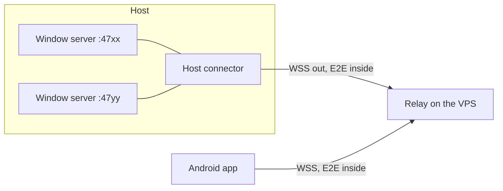

# Remote control prototype: sessions from a phone over a relay

Issue #63 holds the agreed direction. This narrows it to a first prototype the author can use for real: the host (a laptop at home) keeps running windows and agents; the author, on mobile data with an Android phone, continues the work.

## Intent

1. Text work: open the current chat, read what the agent did, answer a question or approve a command, open its spec/plan, comment on passages, send the next message.
2. Media work: open an image or video, mark a region/point or a moment, comment, send.

Success: both from a mobile network against a real home session, without wishing to be at the laptop.

## Goals, non-goals, anti-goals

Goals: Android app (Flutter) reaching the host only through a relay (nothing listens on the host); end-to-end encryption from day one (relay sees ciphertext and routing ids only); pairing by QR shown on the host; several hosts in one app (author's decision: each paired, listed, revoked separately; one relay connection per host; session list grouped by host); session list, chat, approvals and agent questions, stop, compact, model switch, agent restart, usage statistics, Markdown files with text comments, images/videos with markup comments, dictation; a relay on a small VPS (1 vCPU, 512 MB, Ubuntu) as a container from `relay/Dockerfile`.

Non-goals (later, mostly per #63): push notifications; iOS; Windows hosts (#119); typed pairing code with PAKE (QR for now); file editing, Changes, Git log, terminal and `!`; 3D models and HTML pages on the phone; desktop client over the relay; hosted relays for others.

Anti-goals: a relay that stores, queues or logs content; anything on the host accepting inbound connections; a phone that can do more than it was paired for; a homemade cipher/handshake; a second comment flow differing from desktop; desktop features lost or changed.

## Constraints

macOS/Linux hosts, Android phone, relay on Linux amd64 512 MB. `main` rules stand (issues, squash PRs, CI, ports 4790–4795, every UI language, including Flutter: six languages as `LANGS`). The window servers' security model (`docs/architecture.md` section 6) does not loosen: 127.0.0.1 only, token stays on the host. Public repo: neutral fixtures, no personal hosts/domains/keys.

## Decisions

### Shape

- Host connector: one long-running process per host user (`nota-bene remote`, new launcher command, code in `server/src/remote/`). Reads window registries (`~/.nota-bene/windows/`, Codex registry under `providers/codex/`), reaches each window on 127.0.0.1 as existing helpers do (`/hello` proof, then helper bearer), keeps one outgoing WebSocket to the relay. The only new thing touching window servers; servers change only where a feature needs it.
- Relay: Go service in `relay/` (own module), one static binary, TLS by autocert on 443, container image. Pairs a host stream with device streams by host id and forwards bytes; no disk writes beyond the certificate cache, no content in logs, nothing queued while a side is away.
- App: Flutter in `mobile/`, APK installed by hand; no store or developer account.

### Identity, pairing, channel

- Connector and every phone hold a long-term X25519 key pair (host: file under `~/.nota-bene/remote/`, mode 600; phone: Android Keystore storage).
- Pairing: `nota-bene remote pair` (later a Settings button) shows a QR with relay URL, host id, host public key and a one-time 256-bit secret valid a few minutes. The phone connects, proves the secret while sending its public key; the host adds the device and consumes the secret; both key fingerprints are printed for comparison.
- Channel: standard authenticated handshake with both static keys pinned (Noise IK or XX over 25519/ChaChaPoly expected; builder picks maintained implementations and records them); fresh session keys per connection.
- Relay gate: the connector proves host-key possession and gives the relay, in memory only, hashes of paired device keys; the relay drops devices that do not present one. Only a noise filter; the handshake is the real gate.
- Pairing state machine (my call): one pairing in flight; a new `pair` cancels the old code; the secret is consumed by the first successful proof; later presenters are refused and announced on the host.
- Revoking: `nota-bene remote devices` lists, `nota-bene remote revoke <id>` removes and drops the live connection. The device list is a mode-600 file under `~/.nota-bene/remote/` (source of truth); `pair`, `devices`, `revoke` talk to the running connector over a mode-600 Unix socket in that folder; the connector updates the relay filter live (my call).

### What goes through the channel

The app speaks the existing window protocol. One encrypted channel carries multiplexed streams: a WebSocket to a window's `/ws` (the app is a tab of that window); HTTP request/response to its routes (`/file` with Range, `/marks`, `/usage`, `/sessions`, ...); a host-level stream for the session list (windows, provider, project, status) and host online state. The relay sees one connection per host and per phone; its cost is connections and bytes (thousands of idle connections on 1 vCPU/512 MB; for 2–3 hosts and 1–2 phones the limit is bandwidth).

- The connector adds credentials; the phone never holds a window key or cookie.
- Protocol types come from `shared/src/protocol.ts` via a generated JSON Schema, and Dart types from that schema; CI fails on stale output. Schema source (my call): `protocol.ts` is not restructured; the schema is generated from existing types (ts-json-schema-generator or similar) for the messages the app uses; non-converting parts are handwritten and tested against the TypeScript parser's fixtures.
- Video: the app runs a loopback HTTP endpoint serving the player from the channel, Range included.
- Flow control (my call): per-stream credit windows so a slow phone throttles the host; the relay keeps a bounded buffer (~1 MB) per connection and applies backpressure. File size costs mobile data, not droplet memory. No transcoding in the prototype; if mobile traffic hurts, next step is a compressed ffmpeg preview made on the host.

### The app

Brainstorm sketches (screens A–G) are the reference. Decided with the author:

- Start screen: the chat opened last on this device; otherwise (none, or host offline) the session list grouped by host, offline hosts shown offline.
- Navigation: a stack from the chat; files open over it from feed cards and the chat menu (recent files); back returns.
- Comments accumulate above the composer and leave with the next message as on desktop: same batch, anchors (text on Markdown; media anchors with region/point or time), quick labels (`web/src/comments/labels.ts`). The comment sheet is a full-width bottom sheet: quoted selection, labels in a horizontal row, multi-line field.
- Approvals: bottom sheet with the full command in monospace; questions answered in the feed.
- Controls: stop, compact, model (and effort), agent restart, usage.
- Dictation: a mic button in the composer and comment sheet uses the phone's recognition (Android `SpeechRecognizer`, UI language); text lands in the field, edited and sent as typed text (agents take no audio).
- Whisper on the host (author): optional, off by default. Enabling in Settings downloads a local Whisper runtime and model under `~/.nota-bene/` (size shown first). When on, the phone records, audio goes through the channel, the host transcribes and returns text. Without it, or host offline, phone recognition is used. Ships after phone recognition, in the same child issue.
- Rendering: Markdown, code highlighting, KaTeX via a Dart port (`flutter_math_fork` family), Mermaid via a native renderer (`mermaid_flutter` or `merman`) checked against real agent diagrams; WebView only as fallback.
- Host offline: status line with last-seen time; arrived content stays readable; sending disabled, not deferred.
- Look: Nota Bene theme tokens; Darcula first.
- Window ownership (author): the phone is an ordinary tab (`/ws?tab=<id>`); the existing one-tab rule applies ("already open in another tab" with "Work here" takes over; desktop then offers to take back). No new mode or protocol change. Mirrored live tabs were considered and dropped as too heavy.
- App strings (my call): Flutter ARB files, one per `LANGS` language; a test fails when keys differ. Quick-label texts are generated from `web/src/i18n`.

### Trust of a paired phone

Fully trusted (author): the channel carries the window's whole protocol, not an allowlist, so later app features need no connector change. Therefore the app opens only after biometric/PIN (Android BiometricPrompt), and a host revoke cuts a lost phone off at once (my call).

### Deployment

The public repo ships relay source, `relay/Dockerfile` and a `docker run` example; CI builds the image but publishes nothing. Publishing, the droplet setup and domain live outside the repo (author), as does anything built on the relay. The relay takes an optional admission hook so such a service can decide which hosts it accepts without forking. The agent logs in to the droplet only to deploy, with the author's go-ahead each time.

## Left to the builder

Frame format and multiplexing; Noise variant and libraries; schema generator; Flutter state management and packages; how the connector discovers window starts/stops; exact layouts within the sketches; tests at least: Go relay unit tests, connector Vitest against a test window (4790–4795) and a local relay, Flutter widget tests, one scripted phone-client run against a local relay.

## Delivery

One epic with child issues (sub-issues), each merged via its own PR; the first child adding Go or Flutter code adds their builds/tests to CI. Order: protocol schema and Dart types; relay and deployment; host connector and pairing; app shell (pairing, list, chat, controls); Markdown with comments; images and video with markup; usage; dictation.
