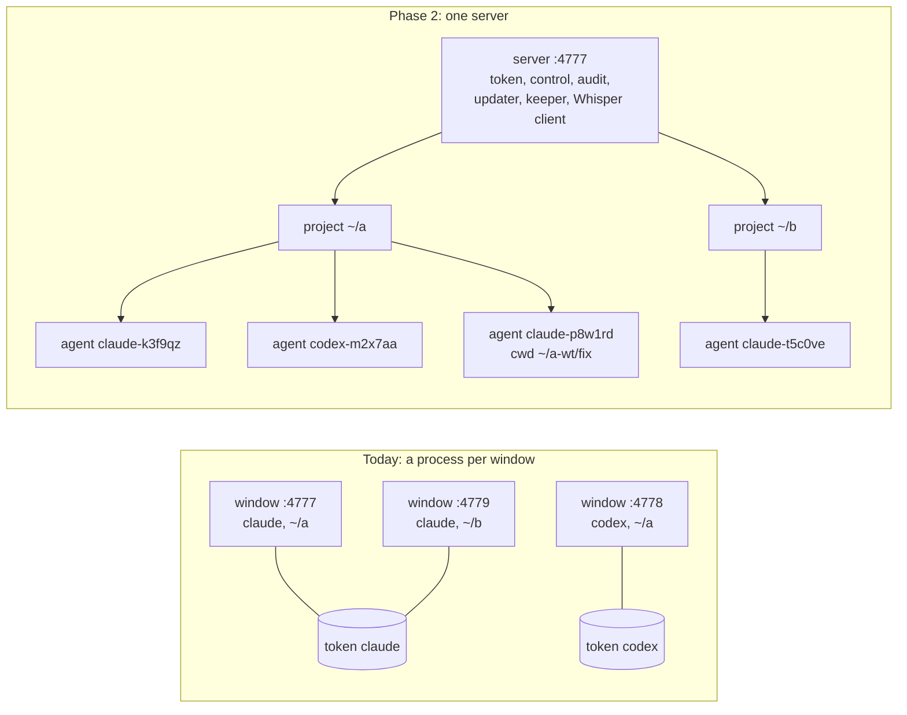
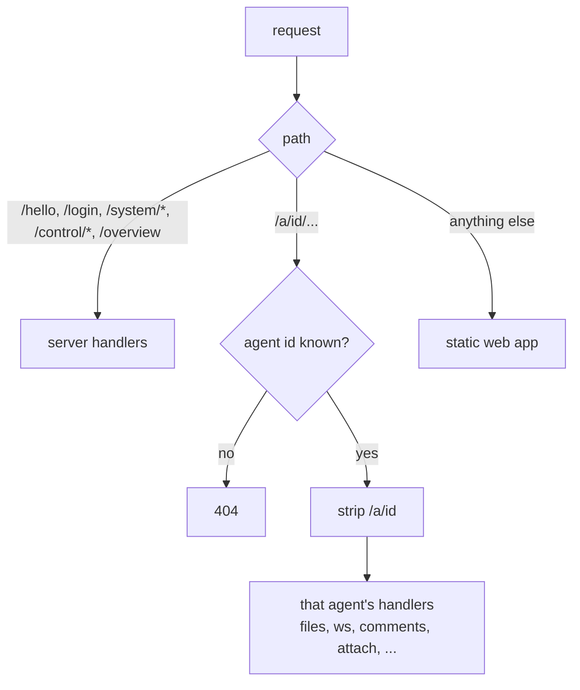
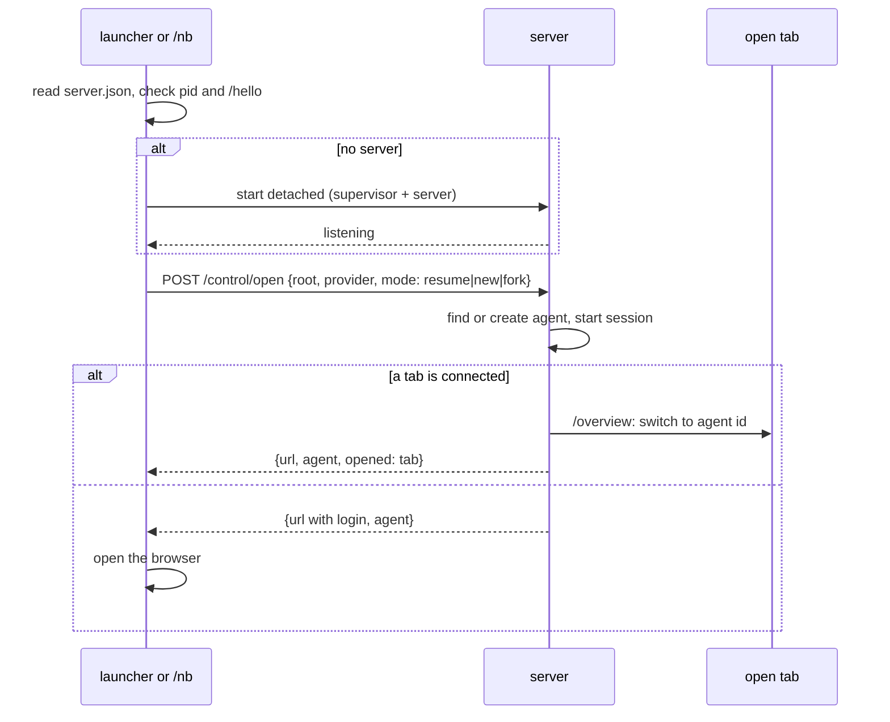
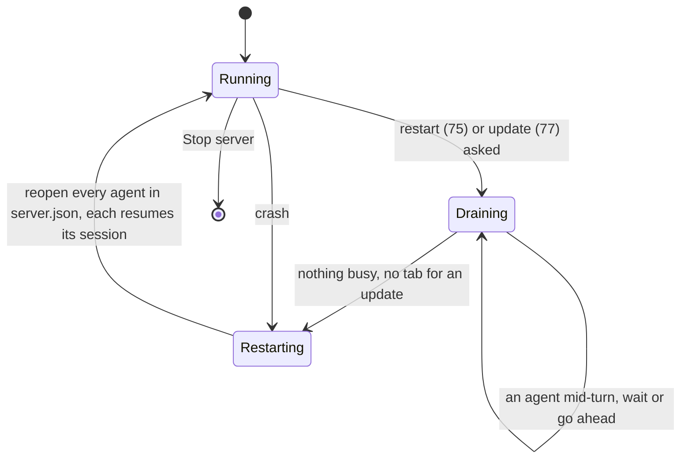
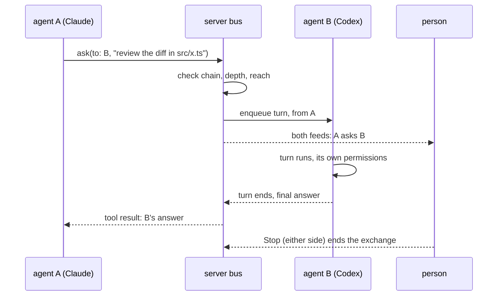
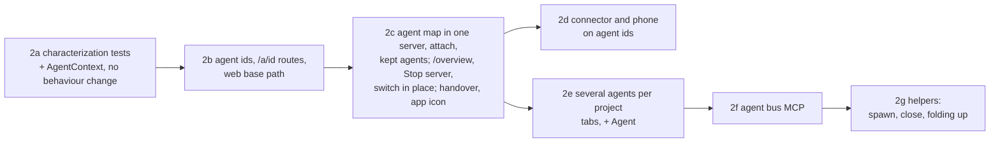

# One server and an agent bus (epic #383 phase 2, #405, #421)

It refines phase 2 of [one tab for all projects](2026-11-15-one-tab-projects-design.md) against
today's code and adds what that design left for later: several agents in one project and agents talking to each other.
Decisions already made there stand unless a section below says otherwise.

## Intent

The direction is managing agents and swarms across projects and computers. Today the unit is a window: one process, port,
token and socket per `(provider, folder)`. A swarm needs a unit smaller than a process and one place that sees all of them:
one server per computer holds every agent; tabs, the phone and other computers address agents, not ports; agents can reach
each other through the server.

Goals: one process and port per computer; any number of agents per project, of any provider; switching agents in one tab;
an agent can ask or tell another agent and the person sees and can stop it; the phone and paired computers see the same
agents. Non-goals now: worktree orchestration (an agent may run in a worktree, nothing creates them for it); per-agent
accounts; a desktop shell. Anti-goals: an agent stopping because a tab closed; anything running that no list shows; agents
looping or spending without the person seeing it; a regression of any provider or of the phone.

## Model



- **Server**: the one process. Holds what is process-wide today or must become so: HTTP listener and port, access token,
  control token, audit log, global prefs, updater, remote keeper, Whisper host client, one backend object per provider.
- **Project**: a folder (`root`) open in the server. Owns per-root prefs, icon, recent entry, files and git views.
- **Agent**: one provider session line in a project, today's window minus the process. Owns the session manager, event
  hub, comment and prompt stores, marks, turn marks, attachments, its socket and the one-tab rule. Its `cwd` is the
  project root or a folder under the same repository (a worktree), which also gives the Git menu's "where the agent
  works" (#129) a real answer.

## Mechanics

### M1. Agent context instead of process env

`stateDir()` picks the provider from `process.env.NOTA_BENE_AGENT` (server/src/state.ts), and 32 call sites in 13 files rely
on it; `startServer` builds every per-agent object from that and from `manager.info().root`. Phase 2 starts by threading an
explicit context through them, with no behaviour change:

```ts
type AgentContext = { id: AgentId; provider: AgentProvider; root: string; cwd: string; stateDir: string };
```

Paths on disk stay where they are (`~/.nota-bene` for Claude, `~/.nota-bene/providers/<p>` otherwise), so sessions,
comments, prompts and marks read unchanged. Only the server-level files (token, control token, registry) move to the base
dir. The ACP backend's single `preopened` slot becomes per agent; Claude and Codex backends are already per session.

### M2. Addressing

- **Agent id**: minted once, kept in the registry: `<provider>-<6 base32>` (`claude-k3f9qz`). Today's `windowKey`
  (`provider:sha1(root)[:16]`) cannot name two agents of one provider in one folder (#405), and it changes when a session
  moves to another folder. Decision for phase 2: an agent's `root` is fixed; today's "switch the session to another folder"
  becomes "open that folder's agent".
- **Routes**: agent routes move under `/a/<id>/…` (files, sessions, comments, attach, voice, marks, cut, restart and stop
  of that agent); server routes stay at the top (`/hello`, login, `/system/*`, `/control/*`, `/overview`). A router strips
  the prefix and hands the rest to the agent's handler, so today's handlers move almost as they are. The web already has
  per-connection `base` (web/src/core/sdk/connections.ts); `SELF` gets `base: '/a/<id>'`, the socket URL takes it too.
- **Sockets**: one per agent, `/a/<id>/ws`, today's protocol inside. A tab holds the socket of the agent on screen;
  switching closes it and opens the next (replay rebuilds the feed). One server socket, `/overview`, streams projects and
  agents with their state to every tab: the switcher, the rail, "N waiting", and "switch to agent X" sent by the launcher.
  As built (2c): no `/overview` socket. The switcher and the rail keep polling `/system/projects`, which lists every agent.
  "Switch to agent X" is the `open-agent` event on the agent socket of the last local tab (`go=1`), and switching is a
  same-origin navigation to `/a/<id>/` (logged in already: the key and the cookie are the port's).



### M3. Auth and entry

- One access token for the server, the base dir's (today's Claude token); credentials stay
  `HMAC(token, port, nonce)`, so a tab logs in once and reaches every agent. Tabs of Codex and omp windows log in once more
  after the move.
- Access checks run on the path after the prefix is stripped, and the remote channel's deny list (`goodPath`) and the
  cookie tier (`cookieRoute`) are applied to that same stripped path, so `/a/<id>/control` cannot slip past a rule written
  for `/control`.
- Entry within one computer needs no hand-off any more: the switcher switches agents inside the same origin. Phase 1's
  login minting from another window's token file goes away. Entry from another computer stays host-granted (#297): the
  host's connector decides, through relay access keys, as now.

### M4. Lifecycle and launcher

- **Registry**: `~/.nota-bene/server.json` `{port, pid, startedAt, version, nonce, agents: [{id, provider, root, cwd, session}]}`
  under a server lock. Per-folder locks become an in-process map.
  As built (2c): the window registry (`windows/<port>.json`) stays the registry, read by the connector and the switcher;
  the agents are kept beside it in `<port>.agents.json`, and the launch lock is one per server. Tokens stay per provider:
  a server keeps the token of the provider it started as, and the launcher logs in with that one (M3's move is not needed
  for attach and would sign every Codex and omp tab out).
- **Attach**: `nota-bene [dir]`, `/nb` in Claude Code and Codex all do the same thing.



- `/nb` no longer runs the window as a Claude Code background task: the server outlives the session that started it.
- **Start by click**: Nota Bene gets an app icon that does what `nota-bene` does with no folder: start the server if
  none runs, then show the last open agent or the starter.
  - `nota-bene shortcut` installs the icon: an app bundle in `~/Applications` on macOS, a Start menu entry on Windows,
    a `.desktop` file on Linux. It runs the installed launcher, so no terminal is needed after the first install.
  - While no icon is installed, the tab shows a one-line notice "Add Nota Bene to your apps" with **Add** (the server
    installs the icon, as `nota-bene shortcut` would) and **Not now** (hidden for 30 days); it never shows again once
    the icon exists. Strings in every UI language.
  - No installable web app: it cannot start a stopped server, so it adds nothing to the icon. A desktop shell later
    replaces the icon.
- **Stop**: "Stop server" in the switcher and `nota-bene stop` stop every agent; "Close project" stops that project's
  agents. A stopped server starts empty next time, previous projects under "Recent".
- **Restart, crash, update**:



  Restart shows which agents are mid-turn and lets the person wait or go ahead (as #422 does for one). A crash now takes
  every agent down at once, so the supervisor's crash restart must reopen all of them and mark cut turns per agent; the
  existing turn marks do that per agent.

- **Old windows during the switch**: listed in the switcher; each hands its folder to the server once it is idle with
  no tab open, then ends, and its session continues as an agent of the server. An old window that updates hands its
  folder to the server and ends.

### M5. Tabs

- The one-tab rule moves from the process to the agent: two tabs may show two agents; a second tab on the same agent gets
  today's `occupied` and "Work here". (#174, phone and desktop in sync with no "Work here", is a separate change and
  becomes easier once the rule is per agent.)
- The switcher and the rail group agents by project; a project tile's badge is over all its agents.

### M6. Remote connector and phone

- The connector finds the one server through `server.json` instead of scanning three registries by port.
- `HostWindow` becomes `HostAgent` with `id` (the agent id) as the key and `port` kept for transport; streams stay
  `{kind, port, path}` with `ws` paths `/a/<id>/ws` allowed. The phone keys chats, caches and embeds by host and agent id
  (today some caches key by port).
- Connector protocol and phone change together; an older phone says "update the app". The window's keeper already
  replaces a connector of an older protocol (#581).

### M7. Several agents in a project (#405, #421 tabs)

- "+ Agent" in a project: provider, and either the project folder or an existing worktree of its repository as `cwd`.
- In the tab: the project's agents as tabs above the feed (provider badge, state dot, waiting badge); the composer,
  comments and attachments go to the agent on screen. A comment addressed to another agent is a later change.
- An agent runs on the computer that holds the folder. "+ Agent" in another computer's project starts it there, through
  that computer's connector, if its host lets this device in; it then talks on that computer's bus.
- Two agents on one working tree are allowed, with a warning in both feeds when they have uncommitted edits to the same
  file in overlapping turns.

### M8. Agent bus

Agents reach each other through an MCP server that Nota Bene hosts. It is the same for every provider and it is where the
person keeps control: every message is a visible event, every exchange can be stopped.

- **Endpoint**: `/a/<id>/mcp` (Streamable HTTP) on the loopback listener. Each agent session is started with it as an MCP
  server and a bearer `HMAC(token, 'mcp', id)`, so the server knows who calls without trusting the caller. The remote
  channel never forwards `/a/<id>/mcp`. A provider without HTTP MCP gets a stdio shim, `nota-bene mcp --agent <id>`, which
  relays to the endpoint.
- **Tools**:
  - `agents` lists the other agents of the caller's project (the bus does not cross projects or computers): id,
    provider, cwd, state, a one-line purpose the person set.
  - `ask(to, text)` delivers `text` as a turn of `to` and returns that turn's final answer when it ends.
  - `tell(to, text)` delivers and returns at once. The reply, if any, arrives later as a `tell` back.
- **Delivery**: a bus message enters the target's send queue (`SendQueue`) like a message typed by the person, marked with
  its sender. A busy target runs it after its current turn; the caller of `ask` waits.
- **Rules**: a message carries its chain (who asked whom); a call whose target is already in its chain is refused (no
  deadlock on A→B→A); a chain has at most 8 hops. `ask` gives up only after 30 minutes with no progress: every event of
  the target's turn (text, a tool call, a permission prompt) restarts the clock, so long work that moves never times out,
  and the caller gets MCP progress notices with the target's latest step. The server sets the providers' own MCP tool
  timeouts above that (Codex `tool_timeout_sec`, Claude's MCP tool timeout) so they do not cut a waiting `ask` first.
  Stopping either turn ends the exchange. The target keeps its own permission mode, and its permission prompts reach the
  person as now.
- **Visibility**: the caller's feed shows the call as a tool line with the reply; the target's feed shows the message with
  "from claude-k3f9qz" and a link to the caller. The overview stream counts open exchanges.



### M9. Agents started by agents

An agent may start a full Nota Bene agent for part of its task: another provider, its own feed, running past the
caller's turn. Unlike the subagents providers already have (inside one session, one provider, no tab of their own).

- **Lead and helpers**: whoever starts an agent leads it. Agents the person adds have no lead. A helper's lead is fixed
  at start; there is no election. The lead is the only agent that may `ask` or `tell` its helpers without being asked
  first; a helper may ask its lead (a question back) and its own helpers, if it has any.
- **Tools**: `spawn(provider, task, cwd?)` starts a helper in the lead's project, runs `task` as its first turn and
  returns its id; `close(id)` ends a helper the caller leads. Results come back as with `ask`.
- **Folding up**: a helper is closed (feed archived and still readable, process gone, tab gone) when its lead closes it,
  when its lead is closed or stopped, or when it has been idle for 15 minutes with no message waiting. The person can
  "Keep" a helper: it loses its lead and stays as an agent of the project.
- **Limits**: at most 4 live helpers per lead and 8 per project; `spawn` past that is refused and says so. Helper depth
  counts toward the chain's 8 hops.
- **Tabs**: helpers sit under their lead as a collapsed group (count and state dots), not as top-level agent tabs, so a
  swarm is one tab with a number.

## Choices made here, with the alternatives

| Fork | Chosen | Instead of | Why |
|---|---|---|---|
| Agent id | minted, kept in `server.json` | `provider:sha1(root)` | several agents of one provider in one folder; root moves |
| Sockets | one per agent + `/overview` | one multiplexed socket | today's protocol and replay unchanged; switching is close and open |
| Bus transport | one HTTP MCP endpoint, stdio shim as fallback | Claude's in-process SDK MCP server | one implementation for all providers |
| Bus delivery | through the target's send queue, as a turn | a side channel the agent polls | the person sees it, stop and permissions work as for any turn |
| Bus before phase 2 | no | relaying between today's windows | it would be rebuilt once agents share a process |

## Phase 2 as pull requests



Each leaves `main` working. 2a carries the characterization tests of today's window (routes, auth tiers, one-tab rule,
restart and update rules) that every later step must keep green.

## Decided in discussion

- The bus stays inside one project: no calls across projects or computers.
- Agents on different computers are different agents; an agent runs where its folder is (M7).
- Start by click: an app icon, offered by a notice in the tab until installed (M4); no installable web app.
- An agent may start helpers; whoever starts one leads it, and helpers fold up on their own: 4 live per lead, 8 per
  project, closed after 15 minutes idle (M9).
- Bus limits: 8 hops; `ask` gives up after 30 minutes without progress, never while the target's work moves (M8).
- Windows running when the new server first starts hand their folders to it once idle and with no tab, then end; their
  sessions continue as agents of the server (M4).

## Risks

- Phase 2 touches auth, routing, the launcher and the phone together; 2a's characterization tests are the guard.
- One crash takes every agent down; the crash restart must reopen all of them, and is tested in 2c.
- Developing Nota Bene inside Nota Bene: restarting the server for a code change restarts every agent of every project.
  The draining step and resume make that safe, not free.
- Bus cost: an exchange spends both agents' quota; the depth limit, the chain check and the visible count are the brakes.
