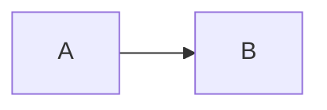

The function below does the work:

```ts
export function sum(a: number, b: number): number {
  return a + b;   // spaces kept in code
}
```

And a diagram:



Text after the diagram.

    indented code block
    second line
